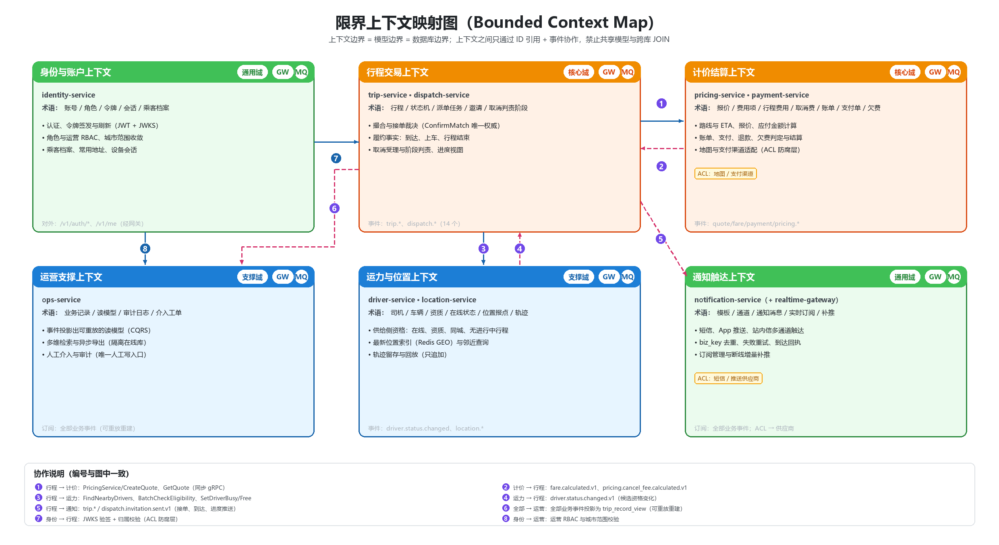
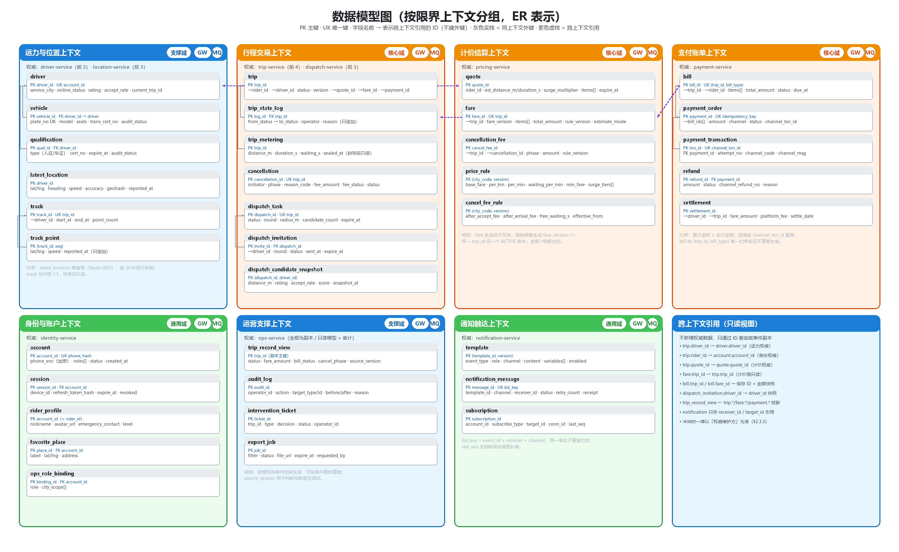
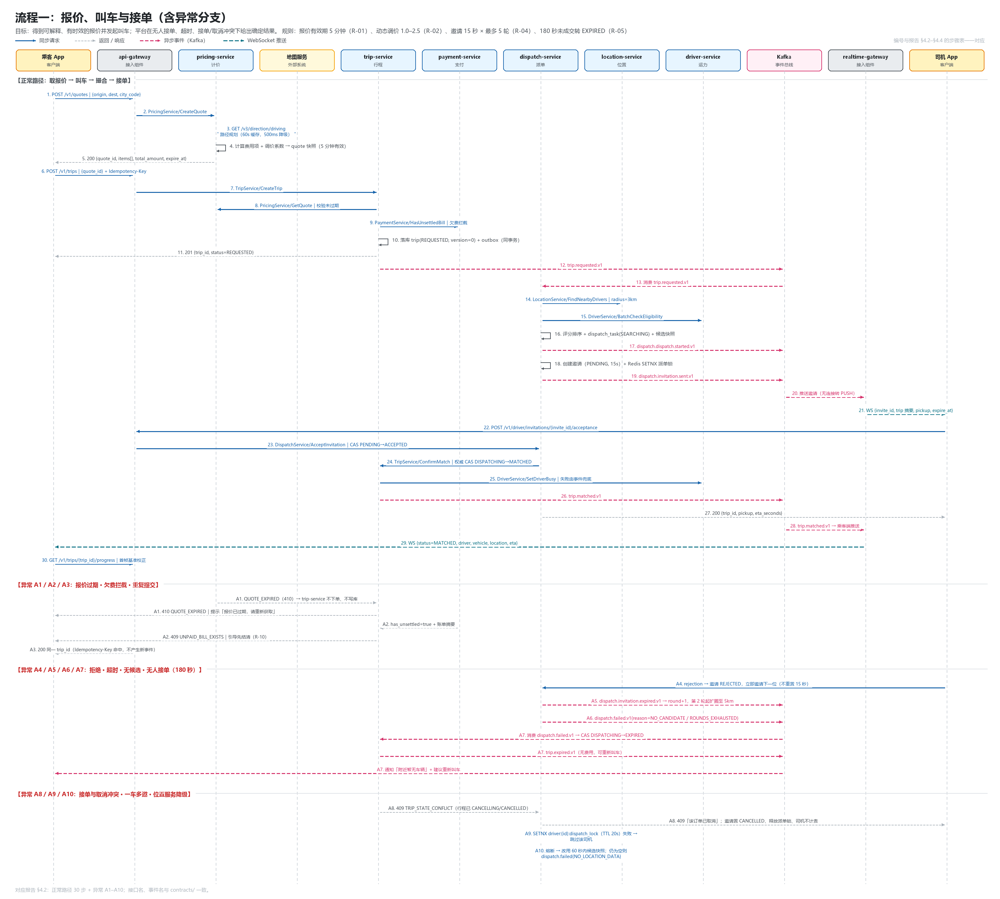
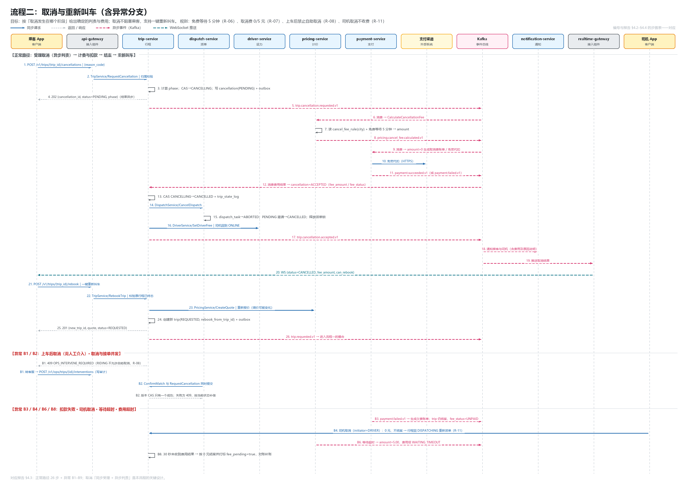
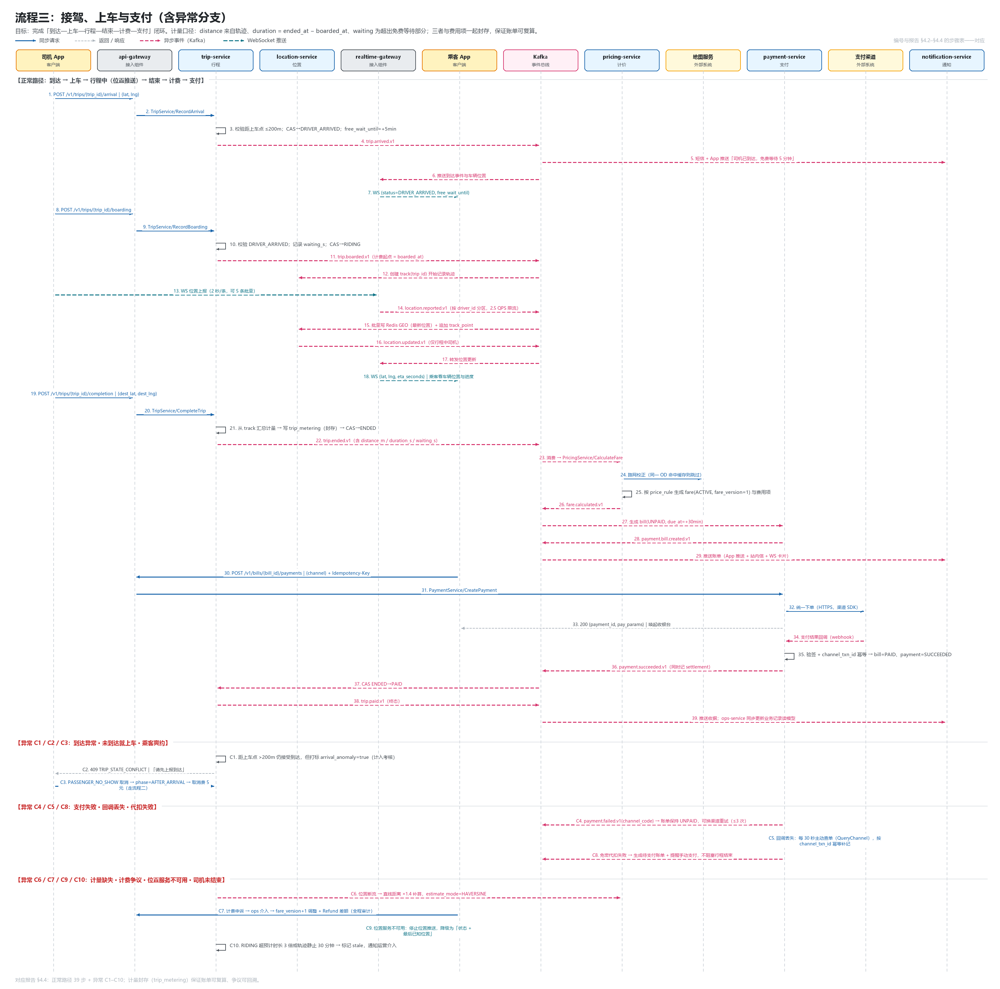
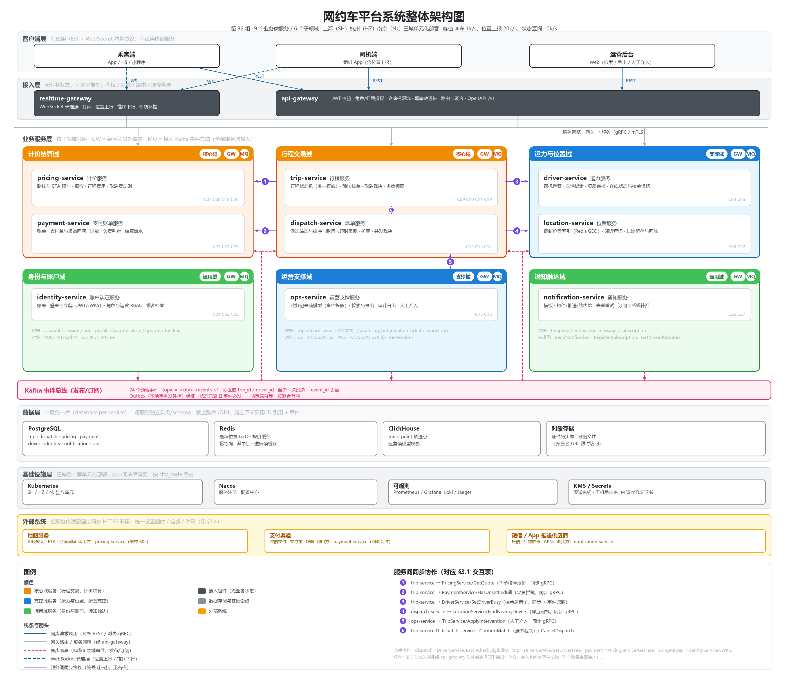

# 网约车平台微服务架构设计报告

> 课程：高级软件工程　实验：Lab 2　小组：第 32 组
> 成员：陈星岩（26113050014）、李思源（26213050248）
> 版本：v1.0　日期：2026-10

## 0. 报告导读

本报告为网约车出行平台（下称"平台"）的微服务架构设计，按实验要求分五部分：

| 章节 | 内容 | 对应提交物 |
| --- | --- | --- |
| 第 1 章 | 领域分析：需求梳理、服务能力识别、子领域划分与类型判定 | `docs/design.md` §1 |
| 第 2 章 | 限界上下文与术语、微服务划分、数据模型与数据归属 | `docs/design.md` §2、`docs/images/context-map.png`、`docs/images/data-model.png` |
| 第 3 章 | 服务通信设计：请求调用 / 消息通信、同步 / 异步、协议选型 | `docs/design.md` §3 |
| 第 4 章 | 三条关键流程的时序图、核心接口、业务事件 | `docs/images/seq-*.png`、`contracts/` |
| 第 5 章 | 系统整体架构图与图例 | `architecture.png` |

**统一的设计基线**（全文一致，也是后续契约与图的命名来源）：

- 城市与容量：上海、杭州、南京三城；峰值 叫车 1,000 次/秒、位置上报 20,000 条/秒、状态查询 10,000 次/秒，三城高峰错峰。
- 服务命名：一律 `<领域>-service`（如 `trip-service`）；网关组件为 `api-gateway`、`realtime-gateway`。
- 全局业务主键：`trip_id`（行程）、`quote_id`（报价）、`fare_id`（行程费用）、`payment_id`（支付单）、
  `dispatch_id`（派单任务）、`invite_id`（派单邀请）、`driver_id`、`rider_id`、`account_id`。
- 行程状态（`trip.status`）取值固定为：
  `REQUESTED` → `DISPATCHING` → `MATCHED` → `DRIVER_EN_ROUTE` → `DRIVER_ARRIVED` → `RIDING` →
  `ENDED`（待支付）→ `PAID`；另有 `CANCELLING`、`CANCELLED`、`EXPIRED` 三个分支终态。
- 事件命名：一律 `<聚合>.<过去式事实>.v1`（如 `trip.matched.v1`），以 Kafka 消息承载。
- 接口命名：对外 REST 为 `/v1/<资源>`；内部 gRPC 为 `rideshare.<上下文>.v1.<Service>/<Method>`。

**本组自行确定的业务细则**（题目未规定，按"设计即规则"的方式记录，全部在报告中显式给出）：

| 编号 | 规则 | 取值 | 出处 |
| --- | --- | --- | --- |
| R-01 | 报价有效期 | 报价快照生成后 5 分钟 | §2.3、§4.2 |
| R-02 | 动态调价系数 | 1.0 ~ 2.5，按城市供需比（`supply/demand`）分档 | §2.3、§4.2 |
| R-03 | 最低消费 | 12 元（不含高速费、停车费） | §2.3 |
| R-04 | 派单邀请超时 | 单个邀请 15 秒，最多 5 轮；首轮半径 3 km，第 2 轮起扩至 5 km | §4.2 |
| R-05 | 无人接单超时 | 叫车后 180 秒未成交转 `EXPIRED` | §4.2 |
| R-06 | 取消免费等待 | 司机到达后免费等待 5 分钟 | §4.3 |
| R-07 | 取消费用 | 司机接单后取消：免费期内 0 元；司机已到达或超免费等待 5 元；取消费全额给司机 | §4.3 |
| R-08 | 上车后取消 | 不允许自助取消，转运营人工介入（`OPS_INTERVENE_REQUIRED`） | §4.3 |
| R-09 | 支付超时 | 行程结束后 30 分钟内未支付，进入催付；超过 24 小时未结清，拦截新叫车 | §4.4 |
| R-10 | 未支付拦截 | 叫车前校验 `payment-service` 是否存在超 24 小时未结清账单 | §4.2 |
| R-11 | 司机取消 | 不向乘客收费；司机侧计入考核，行程回到 `DISPATCHING` 重新派单 | §4.3 |
| R-12 | 位置上报频率 | 司机端 2 秒/条，网关侧按 `driver_id` 限流 2.5 QPS | §3.5 |

---

## 1. 领域分析

### 1.1 梳理业务需求

从乘客、司机、运营人员三类角色的操作出发，把"用户操作"翻译成"系统必须解决的业务问题"，
并抽取出业务概念与所需的业务能力（下表中能力编号 `Cxx` 供 §1.2、§1.3 引用）。

| 需求 | 用户操作 | 系统需解决的业务问题 | 关键概念 | 需要的业务能力 |
| --- | --- | --- | --- | --- |
| N1 | 乘客、司机管理个人资料 | 三类角色如何被唯一标识、认证与授权；资料由谁维护、哪些字段需要加密或审核 | 账号、角色、乘客、司机、资质 | C01、C02、C03、C04 |
| N1 | 司机设置在线状态 | 什么条件下司机才有资格被派单（在线、空闲、资质有效、服务城市匹配） | 在线状态、接单资格、服务城市 | C05、C06 |
| N1 | 运营人员查看业务记录 | 如何在不干扰在线交易的前提下支持运营按乘客/司机/行程维度检索与导出 | 业务记录、读模型、审计日志 | C15、C16 |
| N2 | 乘客选择起终点、查看报价 | 如何把地址解析成坐标与路线，如何给出可解释、可回溯、有时效的报价 | 地址、路线、ETA、报价、调价系数 | C07、C08 |
| N2 | 发起叫车、查询等待进度 | 下单要校验什么；下单后行程如何被别人看见与推进；等待进度从哪里来 | 行程、叫车请求、等待进度 | C09、C10、C11 |
| N3 | 平台寻找候选司机并发出邀请 | 在 20,000 条/秒的位置流中，如何快速找出"该派给谁"，如何避免重复派单 | 候选司机、派单任务、邀请 | C12、C13 |
| N3 | 司机接受或拒绝、乘客看接单结果 | 接受/拒绝与乘客取消可能并发，如何裁决冲突、如何保证一次行程只被一个司机确认 | 接单、冲突裁决、幂等 | C14 |
| N4 | 司机上报位置、乘客查看车辆位置与进度 | 高频位置如何写入、如何被低延迟查询、如何只推给该行程的乘客 | 位置、轨迹、订阅、进度 | C06、C10、C14(实时推送) |
| N5 | 司机前往上车点并上报到达；确认乘客已上车、开始行程 | "到达""上车"这类事实由谁采信、在什么位置条件下成立；计费从哪一刻开始 | 到达、等待计时、上车、行程开始 | C12、C13 |
| N6 | 乘客或司机申请取消；平台处理费用与通知；乘客重新叫车 | 取消在不同阶段的法律与费用后果不同；取消与接单并发时的唯一结果；重新叫车如何复用上下文 | 取消申请、判责、取消费用、重新叫车 | C19、C20、C21、C22 |
| N7 | 到达终点后司机结束行程；平台生成费用；乘客支付并查询账单 | 计费数据从哪来、如何封存；支付与第三方渠道如何最终一致；支付失败与超时怎么办 | 行程结束、里程/时长、账单、支付单、回调 | C17、C18、C23、C24、C25 |

由上表可见，平台要解决的业务问题可以归纳为三类：

1. **交易类**（报价、叫车、撮合、取消）：状态多、并发强、直接决定成交与收入；
2. **履约类**（位置、到达、上车、结束）：高频写入、低延迟读、强时效；
3. **支撑类**（账号、资格、通知、运营检索）：跨行业通用或偏后台，变化频率低于交易类。

### 1.2 识别关键概念与服务能力

**关键概念**（按概念簇列出，概念的精确定义见 §2.1 术语表）：

| 概念簇 | 概念 | 说明 |
| --- | --- | --- |
| 参与者 | 账号、乘客、司机、运营人员、角色 | 同一自然人在不同场景下可能是乘客也是司机，故"账号"独立于"角色档案" |
| 供给 | 司机、车辆、资质、服务城市、在线状态 | 供给的"可派单资格"是易变状态，资质是低频变更的合规数据 |
| 需求 | 行程请求、起终点、路线、报价、调价系数 | 报价是"某一时刻对某条预估路线的价格承诺"，因此必须快照化 |
| 撮合 | 派单任务、候选司机、邀请、接受/拒绝 | 一次叫车对应一个派单任务，任务内多次邀请，最终至多一次成交 |
| 履约 | 行程、到达、等待、上车、行程中、结束 | 行程状态机是履约的唯一权威事实来源 |
| 计量 | 里程、时长、等待时长、费用项、账单 | 计量数据在行程结束时封存，之后只读 |
| 资金 | 支付单、支付流水、退款、取消费用、欠费 | 资金动作全部可追溯到 `payment_id`，并带幂等键 |
| 位置 | 位置报点、最新位置、轨迹、地理索引 | "最新位置"可覆盖，"轨迹"只能追加 |
| 通知 | 通知模板、通道、消息、回执、实时订阅 | 同一业务事实可能触发多渠道、多接收者通知 |
| 运营 | 业务记录、读模型、审计、人工介入 | 运营只读副本 + 受控的人工写操作（需审计） |

**服务能力清单**（"服务能力"= 业务需要完成的事情，尚不涉及具体服务拆分）：

| 编号 | 服务能力 | 所属概念簇 | 触发者 |
| --- | --- | --- | --- |
| C01 | 账号注册与登录（短信验证码 / 三方登录），令牌签发与刷新 | 参与者 | 乘客、司机、运营 |
| C02 | 角色与权限判定（乘客 / 司机 / 运营角色，运营后台 RBAC） | 参与者 | 所有端 |
| C03 | 乘客资料维护（昵称、头像、常用地址、紧急联系人） | 参与者 | 乘客 |
| C04 | 司机资料、车辆绑定与资质审核状态维护 | 供给 | 司机、运营审核 |
| C05 | 司机在线状态与接单资格管理（上线/下线、置忙） | 供给 | 司机、派单 |
| C06 | 位置上报写入、最新位置索引与邻近司机查询 | 位置 | 司机端、派单 |
| C07 | 地址解析与路线/ETA 预估 | 需求 | 乘客端、计价 |
| C08 | 行程报价（预估里程时长、动态调价、报价快照与有效期） | 需求 | 乘客 |
| C09 | 发起叫车与下单校验（角色、城市、资质、未支付欠费） | 需求 | 乘客 |
| C10 | 行程状态机维护（唯一权威状态、状态变更日志） | 履约 | 各参与方 |
| C11 | 叫车等待进度与行程进度查询 | 履约 | 乘客 |
| C12 | 候选司机筛选与排序（在线、空闲、距离、评分、服务区） | 撮合 | 派单 |
| C13 | 派单邀请、超时重派、扩圈与失败处理 | 撮合 | 派单 |
| C14 | 接单确认、并发冲突裁决（与取消、重复接受、超时竞争） | 撮合 | 司机 |
| C15 | 业务记录读模型维护与多维检索（订单/司机/结算/导出） | 运营 | 运营 |
| C16 | 审计日志记录与运营人工介入（上车后取消、判责复核） | 运营 | 运营 |
| C17 | 里程/时长/等待等计量数据封存 | 计量 | 司机、行程 |
| C18 | 行程费用计算（基础价、里程费、时长费、等待费、附加费、调价、优惠） | 计量 | 行程结束 |
| C19 | 取消申请受理与"取消 vs 接单"状态裁决 | 履约 | 乘客、司机 |
| C20 | 取消判责与取消费用计算（按阶段、免费等待、司机取消） | 计量 | 取消受理 |
| C21 | 取消结果通知与重新叫车引导（复用起终点与报价上下文） | 通知 / 需求 | 平台 |
| C22 | 行程轨迹留存与回放查询 | 位置 / 运营 | 运营、客服 |
| C23 | 账单生成与账单查询（费用明细、优惠、应付金额） | 资金 | 行程结束 |
| C24 | 支付下单、渠道回调、退款与对账 | 资金 | 乘客、支付渠道 |
| C25 | 欠费拦截与催付（末次未结清账单） | 资金 | 叫车前置校验 |
| C26 | 多通道通知（短信/推送/站内信）、模板、去重与重试 | 通知 | 各业务域 |
| C27 | 实时推送通道管理（连接、订阅、断线恢复、增量补推） | 通知 | 乘客端、司机端 |

### 1.3 根据内聚性划分子领域

划分依据有三条：**共享业务问题**（解决同一类业务问题）、**概念与规则紧耦合**（变更时往往一起变）、
**业务能力闭环**（能对业务交付一个可独立演进的成果）。据此得到 6 个子领域：

#### 1.3.1 行程交易域（Trip Transaction）

- **业务范围**：从"发起叫车"到"行程进入终态"的全部交易过程——下单、派单撮合、接单、接驾、上车、
  行程中、结束、取消裁决，以及向乘客暴露的等待/进度查询。
- **关键概念**：行程（trip）、行程状态、派单任务、候选司机、邀请、接单、到达、上车、取消申请、判责阶段。
- **服务能力**：C09、C10、C11、C12、C13、C14、C17、C19、C22(行程侧)。
- **划分依据**：这些能力共享同一个**聚合根"行程"**和同一台**状态机**；"派单—接单—取消"三者必须
  在同一处做并发裁决（一次行程只能被一个司机确认、取消与接单只能有一个胜出），把它们拆到不同子领域
  会迫使状态机跨域分布，无法保持一致性。注意：派单在子领域内独立成服务（性能原因），但归属本域。

#### 1.3.2 计价结算域（Pricing & Settlement）

- **业务范围**：报价、行程费用计算、取消费用计算、账单、支付与退款、欠费与催付、司乘结算流水。
- **关键概念**：路线预估、报价快照、调价系数、费用项、行程费用（fare）、取消费用、账单、支付单、
  支付流水、退款、欠费。
- **服务能力**：C07、C08、C18、C20、C23、C24、C25。
- **划分依据**：报价、计价、结算、支付是**同一套价格与资金规则**的不同阶段，规则由运营按城市配置、
  变化频率最高（调价策略、优惠活动、取消费规则），且涉及资金安全与对账，必须与交易流程解耦以便
  独立灰度与审计。此域直接决定收入与价格竞争力，属核心域。

#### 1.3.3 运力与位置域（Supply & Location）

- **业务范围**：司机档案、车辆与资质合规、在线状态与接单资格；位置上报、最新位置索引、邻近查询、
  轨迹留存与回放。
- **关键概念**：司机、车辆、资质（人证/车证）、服务城市、在线状态、接单资格、位置报点、地理索引（geohash）、轨迹。
- **服务能力**：C04、C05、C06、C22。
- **划分依据**：本域回答"谁可以被派单"和"司机在哪里"，是撮合的输入而非交易本身；其数据特征是
  高频写入、可覆盖（最新位置）、时效敏感（位置 30 秒未更新即视为失联），与交易域的低频强一致写入
  截然不同，因此独立成域。20,000 条/秒的位置写入量也要求它拥有独立的存储与扩容策略。

#### 1.3.4 身份与账户域（Identity & Account）

- **业务范围**：账号、登录与令牌、角色与权限、乘客资料与安全设置。
- **关键概念**：账号、角色（RIDER / DRIVER / OPS_ADMIN / OPS_SUPPORT）、令牌、会话、乘客档案、实名信息。
- **服务能力**：C01、C02、C03。
- **划分依据**：认证授权是跨行业通用能力，行业差异小，宜复用成熟方案（OIDC / JWT）；乘客资料
  与账号强绑定（1:1），一并放入本域。司机档案不放这里，因为它承载资质审核与接单资格等业务规则。

#### 1.3.5 通知触达域（Notification）

- **业务范围**：通知模板与多通道发送（短信、App 推送、站内信）、去重、重试、回执；
  以及面向 C 端的实时推送通道（WebSocket 连接、订阅、断线重连后的增量补推）。
- **关键概念**：模板、通道、接收者、消息、回执、实时订阅、连接。
- **服务能力**：C21(通知侧)、C26、C27。
- **划分依据**：通知被几乎所有子领域使用，若分散实现会导致模板与频控规则重复；通道供应商
  更换频繁、失败重试策略统一，是典型的通用能力。

#### 1.3.6 运营支撑域（Operations）

- **业务范围**：面向运营的业务记录检索与导出、审计日志、人工介入（上车后取消、判责复核）、对账辅助。
- **关键概念**：业务记录读模型、检索条件、导出任务、审计日志、工单。
- **服务能力**：C15、C16。
- **划分依据**：运营只看"已发生的事实"，天然适合以**读模型 + 事件投影**方式隔离，避免运营的大范围
  查询与导出压垮在线交易库；同时给出一个受控的人工写入口，所有操作留痕。

#### 1.3.7 子领域与需求、能力的对应关系

| 子领域 | 覆盖需求 | 覆盖能力 | 是否闭环 |
| --- | --- | --- | --- |
| 行程交易域 | N2、N3(撮合)、N5(行程侧)、N6(取消裁决) | C09–C14、C17、C19 | 是：一单行程从下单到终态 |
| 计价结算域 | N2(报价)、N7 | C07、C08、C18、C20、C23–C25 | 是：一个价格从报价到收款 |
| 运力与位置域 | N1(司机侧)、N4 | C04、C05、C06、C22 | 是：一名司机从注册到可被派单、被定位 |
| 身份与账户域 | N1(乘客新)、所有端的认证 | C01–C03 | 是：一次登录到资料维护 |
| 通知触达域 | N6(通知)、N3(接单结果)、N7(账单) | C21、C26、C27 | 是：一条事实到一次触达 |
| 运营支撑域 | N1(运营)、N6(N6 人工介入) | C15、C16 | 是：一次查询/介入的闭环 |

### 1.4 确定子领域类型

| 子领域 | 类型 | 判定理由 |
| --- | --- | --- |
| 行程交易域 | **核心域** | 撮合效率与履约体验就是平台的核心价值：派单策略（半径、分轮、评分权重）、取消裁决、状态机设计直接决定成交率与乘客/司机体验，是同行竞争的主战场，必须自研并快速迭代。 |
| 计价结算域 | **核心域** | 定价与动态调价直接影响收入与价格竞争力；取消费、优惠、司乘分成是规则密集且频繁调整的业务策略；资金链路的正确性与合规性构成竞争壁垒。 |
| 运力与位置域 | **支撑域** | 支撑撮合开展，且具行业特殊性（网约车双证合规、服务城市资质、接单资格），但不构成差异化竞争点；位置与推送的技术实现较通用，可借助成熟组件（Redis GEO、Kafka）实现。 |
| 身份与账户域 | **通用域** | 账号、登录、令牌、RBAC 在各行业几乎一致，可直接采用成熟方案（OIDC 提供商或开源 IdP）复用。 |
| 通知触达域 | **通用域** | 短信/推送/站内信与 WebSocket 推送在各行业普遍适用，能力差异主要在供应商与模板管理，适合复用现成平台能力。 |
| 运营支撑域 | **支撑域** | 面向内部运营，需要贴合本平台的业务记录语义（行程、派单、结算）与判责流程，具一定业务特殊性；但不直接面向外部用户、不构成竞争优势。 |

**判定标准的一致性说明**：核心/支撑的界线取"是否直接影响成交与收入、是否需要在同行间形成差异"。
行程交易与计价结算都满足"直接影响成交/收入 + 规则密集 + 需自研迭代"，故同为核心域；运力与位置、
运营支撑虽属必要且有一定行业特殊性，但可借助通用技术快速实现，故为支撑域；身份与通知在行业内
高度同质，为通用域。

---

## 2. 微服务划分与数据归属

### 2.1 确定限界上下文与基本术语

六个子领域各自对应一个限界上下文（**上下文边界 = 模型边界 = 数据库边界**）：上下文内部术语、
规则与模型含义唯一；上下文之间只通过 `ID 引用 + 事件 + 少量快照字段` 通信，不允许共享模型对象。
限界上下文的协作关系见下图（`docs/images/context-map.png`）：



图例：实线箭头 = 客户/供应商式**同步调用**（下游调用上游，箭头指向被调用方）；虚线箭头 =
**异步事件**（发布方 → 订阅方，箭头指向订阅方）；`ACL` 标记 = 需要防腐层的上下文。

#### 2.1.1 行程交易上下文（Trip Context）

- **负责的业务范围**：行程的创建与全生命周期状态、派单单（撮合过程）、接单确认、接驾与到达、上车与
  行程开始/结束的登记、取消受理与阶段裁决、面向乘客的行程进度视图组装。
- **不负责**：价格怎么算（计价上下文）、司机在哪里（位置上下文）、钱怎么收（支付上下文）。
- **基本术语**：

| 术语 | 标识 | 定义 |
| --- | --- | --- |
| 行程 | `Trip` / `trip_id` | 一次从叫车到终态的交易实体，承载唯一权威状态；创建后不可删除，只能进入终态 |
| 行程状态 | `trip.status` | 状态机当前状态：`REQUESTED`/`DISPATCHING`/`MATCHED`/`DRIVER_EN_ROUTE`/`DRIVER_ARRIVED`/`RIDING`/`ENDED`/`PAID`/`CANCELLING`/`CANCELLED`/`EXPIRED` |
| 叫车请求 | `Trip Request` | 乘客提交的一次下单动作，产生一个 `REQUESTED` 行程 |
| 报价引用 | `quote_id` | 行程上引用的报价（见计价上下文），同时保存金额快照用于展示 |
| 派单任务 | `Dispatch Task` / `dispatch_id` | 一次叫车对应的一次撮合过程，独立于行程状态机之外的生命周期 |
| 候选司机 | `Candidate` | 满足在线、空闲、同城、距离、资质有效等条件的司机（本上下文只保存派单所需快照） |
| 派单邀请 | `Invitation` / `invite_id` | 向一个候选司机发出的一次接单机会，有独立有效期与结果（`PENDING`/`ACCEPTED`/`REJECTED`/`EXPIRED`） |
| 接单 | `Acceptance` | 司机接受邀请并成为该行程唯一司机的行为；成功后不可撤销，只能取消 |
| 接驾 | `En Route` | 接单后前往上车点的阶段（`DRIVER_EN_ROUTE`） |
| 到达 | `Arrival` | 司机到达上车点的事实（`DRIVER_ARRIVED`），触发免费等待计时 |
| 上车 | `Boarding` | 乘客上车、司机确认的事实，触发 `RIDING` 并通知计价开始计费 |
| 取消申请 | `Cancellation Request` | 乘客或司机发起的取消意图，经判责后才能进入 `CANCELLED` |
| 判责阶段 | `Cancellation Phase` | 取消发生时的阶段：`BEFORE_ACCEPT`/`AFTER_ACCEPT`/`AFTER_ARRIVAL`/`AFTER_RIDING` |
| 行程进度 | `Trip Progress` | 面客视图：状态 + 车辆最新位置 + ETA + 关键时间点 |
| 计量封存 | `Metering Snapshot` | 行程结束时固化的里程、时长、等待时长、路径摘要（`fare` 的计算输入） |

#### 2.1.2 计价结算上下文（Pricing & Settlement Context）

- **负责的业务范围**：路网路线与 ETA 预估、报价生成、行程费用（fare）计算、取消费用计算、账单生成、
  支付下单与渠道回调、退款、欠费判定、司机/平台结算流水。
- **不负责**：行程能不能取消（交易上下文裁决）、司机资质（运力上下文）。
- **基本术语**：

| 术语 | 标识 | 定义 |
| --- | --- | --- |
| 路线预估 | `Route Estimate` | 由地图服务得到的预计里程与时长，是报价与费用计算的共同输入 |
| 报价 | `Quote` / `quote_id` | 对一条预估路线的价格承诺快照；内容含预估里程/时长、费用项、调价系数、总额、有效期（5 分钟） |
| 调价系数 | `surge_multiplier` | 按城市供需比分档的 1.0 ~ 2.5 系数，报价时定档并写入快照 |
| 费用项 | `Fare Item` | 可解释的一项金额，`item_type` ∈ `BASE`/`DISTANCE`/`TIME`/`WAITING`/`TOLL`/`SERVICE_FEE`/`DISCOUNT`/`SURGE` |
| 行程费用 | `Fare` / `fare_id` | 行程结束后按计量封存计算出的应付金额与明细；生成后不可修改，调整只能生成新版本 `fare_version` |
| 取消费用 | `Cancellation Fee` | 因取消产生的费用，由判责阶段与 `cancel_fee_rule` 决定，取值 0 或正值 |
| 账单 | `Bill` / `bill_id` | 面向乘客的应收凭证，可包含多项费用（行程费、取消费、违约金） |
| 支付单 | `Payment Order` / `payment_id` | 一次支付意图，含金额、渠道、幂等键与状态机 |
| 支付流水 | `Payment Transaction` / `txn_id` | 与渠道交互的一次尝试，记录渠道流水号与渠道返回码 |
| 欠费 | `Unpaid Bill` | 超过 24 小时未结清的账单，用于叫车前拦截（R-10） |
| 结算流水 | `Settlement` | 司机应收、平台收入的记账记录，供对账 |

#### 2.1.3 运力与位置上下文（Supply & Location Context）

- **负责的业务范围**：司机档案与车辆绑定、资质合规与审核状态、服务城市、在线状态与接单资格；
  位置报点写入、最新位置索引、邻近司机查询、行程轨迹留存与回放。
- **不负责**：把行程派给谁（交易上下文决策）、司机评分如何影响排序（派单策略在交易上下文）。
- **基本术语**：

| 术语 | 标识 | 定义 |
| --- | --- | --- |
| 司机 | `Driver` / `driver_id` | 具备接单资格的供给主体，一个账号至多一个司机档案 |
| 车辆 | `Vehicle` / `vehicle_id` | 与司机绑定的运营车辆（车牌、车型、座位数、营运证） |
| 资质 | `Qualification` | 人证（驾驶员证）、车证（运输证）及其有效期与审核状态 |
| 服务城市 | `service_city` | 司机获准运营的城市编码 `SH`/`HZ`/`NJ` |
| 在线状态 | `online_status` | `OFFLINE`/`ONLINE`/`BUSY`——业务资格状态，与位置新鲜度无关 |
| 接单资格 | `dispatch_eligibility` | `online_status=ONLINE` ∧ 资质有效 ∧ 无冷却 ∧ 无进行中行程 |
| 位置报点 | `Location Report` | 司机端一次采样上报：`lat`/`lng`/`heading`/`speed`/`accuracy`/`reported_at` |
| 最新位置 | `Latest Location` | 每位司机唯一、可覆盖的最新位置，写 Redis GEO 供邻近查询 |
| 轨迹 | `Track` / `track_id` | 一次行程内的报点追加序列，与 `trip_id` 一对一 |
| 位置新鲜度 | `freshness` | 最近报点距今 ≤ 30 秒视为新鲜；过期不参与派单候选 |

#### 2.1.4 身份与账户上下文（Identity & Account Context）

- **负责的业务范围**：账号、登录与令牌、角色与权限（含运营 RBAC）、乘客档案与安全设置。
- **基本术语**：

| 术语 | 标识 | 定义 |
| --- | --- | --- |
| 账号 | `Account` / `account_id` | 平台唯一身份，绑定手机号（加密存储），可持有多个角色 |
| 角色 | `Role` | `RIDER`/`DRIVER`/`OPS_ADMIN`/`OPS_SUPPORT` |
| 令牌 | `Token` | JWT 访问令牌（30 分钟）+ 刷新令牌（30 天）；声明含 `account_id`/`roles`/`city_code` |
| 会话 | `Session` | 刷新令牌与设备绑定关系，可主动吊销 |
| 乘客档案 | `Rider Profile` / `rider_id` | 乘客侧资料；`rider_id = account_id` |
| 常用地址 | `Favorite Place` | 乘客保存的家庭/公司等地点 |
| 运营权限 | `Ops Permission` | 运营人员可执行的操作集合（按角色 + 城市范围判定） |

#### 2.1.5 通知触达上下文（Notification Context）

- **负责的业务范围**：通知模板、多通道发送（短信/推送/站内信）、去重与重试、回执；实时推送长连接、
  订阅管理、断线重连后的增量补推。
- **基本术语**：

| 术语 | 标识 | 定义 |
| --- | --- | --- |
| 通知模板 | `Template` / `template_id` | 按事件与角色定义的文案与变量集合 |
| 通知消息 | `Notification Message` / `message_id` | 一次具体发送任务（模板 × 通道 × 接收者），按 `biz_key` 去重 |
| 通道 | `channel` | `SMS`/`PUSH`/`INBOX` |
| 回执 | `Receipt` | 通道返回的送达/失败结果，用于重试与统计 |
| 实时订阅 | `Subscription` | 客户端对 `trip_id`/`driver_id` 的位置与进度订阅 |
| 连接 | `Connection` / `conn_id` | 一条 WebSocket 连接，绑定 `account_id`、角色与订阅集合 |

#### 2.1.6 运营支撑上下文（Operations Context）

- **负责的业务范围**：业务记录读模型、多维检索与导出、审计日志、人工介入工单。
- **基本术语**：

| 术语 | 标识 | 定义 |
| --- | --- | --- |
| 业务记录 | `Business Record` | 面向运营的行程/司机/结算只读视图 |
| 读模型 | `Read Model` | 由领域事件投影生成、可从事件重放的查询副本 |
| 检索条件 | `Query Filter` | 时间范围、城市、状态、手机号后四位、司机车牌等 |
| 导出任务 | `Export Job` | 异步导出（生成文件、通知下载、限流） |
| 审计日志 | `Audit Log` / `audit_id` | 记录运营人员与系统的人工写操作、原因与结果 |
| 介入工单 | `Intervention Ticket` / `ticket_id` | 上车后取消、异常判责复核等人工处理单据 |

#### 2.1.7 同名异义与关联方式

参考课件中"车票"在销售与运营执行两个上下文中含义不同的例子，本平台存在多处同名异义。
**处理原则**：每个上下文在代码与库表中使用自己的模型，跨上下文只传 `ID + 快照`，
术语的"权威定义"只属于拥有该数据的上下文。

| 术语 | 上下文 A 的含义 | 上下文 B 的含义 | 关联标识 |
| --- | --- | --- | --- |
| 行程 | **交易上下文**：有状态机的交易实体，权威，可变更状态 | **计价上下文**：只读的计费对象（`trip_id` + 计量封存），决定费用 | `trip_id`；计价侧不做状态变更 |
| 行程 | **位置上下文**：位置跟踪会话（`track_id` 与 `trip_id` 一对一） | **运营上下文**：读模型中的一行（含展示用冗余字段），可重建 | `track_id` → `trip_id` |
| 司机 | **运力上下文**：有资质、车辆、服务城市、在线状态的供给主体（权威） | **派单上下文**：候选（`driver_id` + 距离/评分/上次接单时间快照） | `driver_id`；派单侧缓存快照 |
| 司机 | **计价上下文**：结算收款方（`settle_account_id`） | **交易上下文**：行程的履约方（`driver_id`），不含结算信息 | `driver_id` + `settle_account_id` |
| 在线 | **运力上下文**：`ONLINE` 业务资格（司机主动上下线） | **位置上下文**：位置新鲜（≤30 秒有报点），只表示数据有效性 | 两个字段并存，派单要求 `ONLINE` **且** 新鲜 |
| 报价 | **计价上下文**：价格承诺快照（`quote_id`，5 分钟有效，可重算） | **交易上下文**：行程上的 `quote_id` 引用 + 金额快照（仅用于展示与比对） | `quote_id` |
| 取消 | **交易上下文**：状态流转（`CANCELLING` → `CANCELLED`）+ 判责阶段 | **计价上下文**：一个取消费用项/账单行 | `trip_id`；计价订阅 `trip.cancellation.accepted.v1` |
| 账单 | **计价上下文**：应收凭证（`bill_id`，可含多项费用） | **支付上下文**：支付的金额来源（`bill_id` 集合），只管收钱 | `bill_id` |
| 接单 | **派单上下文**：一次邀请被接受的事实（`invite_id`） | **交易上下文**：行程进入 `MATCHED` 的一次状态转移 | `trip_id` + `invite_id` |
| 结束 | **交易上下文**：司机确认结束（`ENDED`，待支付） | **计价上下文**：计量封存完成的触发点（据此算 `fare`） | `trip_id`；事件 `trip.ended.v1` |

### 2.2 确定微服务及划分依据

#### 2.2.1 微服务清单

共划分 **9 个业务微服务**，另有 2 个接入组件（`api-gateway`、`realtime-gateway`）和 1 套基础设施，
接入组件不承载业务规则，不计入业务服务。

| # | 微服务 | 所属子领域 | 业务职责 | 提供的能力 | 主要依赖（同步 → / 异步 ⇒） | 主要划分依据 |
| --- | --- | --- | --- | --- | --- | --- |
| 1 | `trip-service` 行程服务 | 行程交易域（核心） | 行程创建与状态机权威、接驾/到达/上车/结束登记、取消受理与阶段裁决、进度视图组装 | C09、C10、C11、C17、C19、C22(行程侧) | → `pricing-service`、`payment-service`、`driver-service`、`notification-service`；⇒ 发布 `trip.*` 事件 | 聚合边界。"行程"是唯一需要串行化变更的聚合根，状态机必须单点权威；变更频率最高、最需要快速灰度 |
| 2 | `dispatch-service` 派单服务 | 行程交易域（核心） | 候选司机筛选与排序、邀请发放与超时、扩圈重派、接单并发裁决 | C12、C13、C14 | → `location-service`、`driver-service`；⇒ 消费 `trip.requested.v1`，发布 `dispatch.*` | 性能与部署。撮合是 1,000 次/秒 × 多轮邀请的突发计算，需要独立线程池、独立扩缩容与独立熔断；算法（距离/评分/轮次）迭代频率远高于行程状态机 |
| 3 | `pricing-service` 计价服务 | 计价结算域（核心） | 路线与 ETA 预估、报价、行程费用、取消费用规则 | C07、C08、C18、C20 | → 地图服务（外部）；被 `trip-service`/`payment-service` 调用；⇒ 消费 `trip.ended.v1`、`trip.cancellation.accepted.v1` | 变化频率。价格规则由运营按城市配置、灰度频繁，必须独立发布；规则引擎与交易流程的生命周期完全不同 |
| 4 | `payment-service` 支付账单服务 | 计价结算域（核心） | 账单生成、支付单与渠道交互、回调幂等、退款、欠费判定、结算流水 | C23、C24、C25 | → 支付渠道（外部）；被 `trip-service` 调用；⇒ 发布 `payment.*` | 合规与安全。资金链路需要独立审计、独立密钥与限权、独立对账窗口；渠道适配层随渠道变更而变 |
| 5 | `driver-service` 运力服务 | 运力与位置域（支撑） | 司机档案、车辆绑定、资质审核状态、在线状态与接单资格 | C04、C05 | 被 `dispatch-service`、`trip-service` 调用；⇒ 发布 `driver.status.changed.v1` | 数据与规则内聚。资质/车辆/服务城市属于低频、强校验的合规数据，与位置的高频遥测完全不同 |
| 6 | `location-service` 位置服务 | 运力与位置域（支撑） | 位置报点写入与最新位置索引、邻近司机查询、轨迹留存与回放 | C06、C22 | 被 `dispatch-service` 调用；⇒ 消费 `location.reported.v1`、`trip.*`；发布 `location.*` | 性能与存储。20,000 条/秒写入、Redis GEO + 列式轨迹库，与事务库的技术栈不同；需独立降级（位置故障不得阻断上下线） |
| 7 | `identity-service` 账户认证服务 | 身份与账户域（通用） | 账号、登录（验证码/三方）、令牌签发与刷新、角色与运营 RBAC、乘客档案 | C01、C02、C03 | 被 `api-gateway` 校验 JWKS；⇒ 发布 `account.registered.v1` | 通用性。可直接复用成熟 IdP 能力，稳定、低频变更，与业务代码解耦 |
| 8 | `notification-service` 通知服务 | 通知触达域（通用） | 模板管理、多渠道发送、去重/重试/回执；WebSocket 会话与订阅（由 `realtime-gateway` 承载连接，本服务管订阅与补推） | C21、C26、C27 | → 短信/推送供应商（外部）；⇒ 订阅各域事件 | 通用性 + 供应商易变。模板与频控规则跨域共用，通道替换不应改动业务服务 |
| 9 | `ops-service` 运营支撑服务 | 运营支撑域（支撑） | 业务记录读模型、检索与导出、审计日志、人工介入工单 | C15、C16 | ⇒ 订阅全部业务事件；→ `trip-service`（人工操作） | 读负载隔离。大范围查询/导出不得压在在线交易库上，读模型可独立重建 |

**接入组件**（无业务状态，仅做协议转换、鉴权前置、限流、路由与会话管理）：

| 组件 | 职责 | 为什么不算业务服务 |
| --- | --- | --- |
| `api-gateway` | 统一 REST 入口、JWT 校验、限流（按角色/接口）、请求路由与聚合、幂等键透传 | 不持有业务数据与业务规则，可水平复制、可替换 |
| `realtime-gateway` | WebSocket 长连接（乘客端/司机端）、订阅上行、位置与进度下行推送、断线重连与补推 | 只做连接与转发；订阅关系持久化在 `notification-service`，会话状态可重建 |

#### 2.2.2 划分时考虑的因素

1. **性能需求**（最主要的拆分动因）
   - 位置链路 20,000 条/秒 vs 叫车 1,000 次/秒 vs 查询 10,000 次/秒，三者相差 1~2 个数量级。
     把 `location-service`、`dispatch-service` 独立出来，才能按各自的峰值单独扩容与限流，
     避免位置写入把交易线程池打满。
   - `dispatch-service` 的每次叫车要算候选、发邀请、等超时，属于 IO 等待 + 定时器密集的负载，
     与行程状态机的短事务特征不同，独立部署后可单独调优（如使用时间轮管理 15 秒邀请超时）。
2. **部署与运营策略**
   - 三城单元化部署：每个城市一套服务实例 + 独立 Kafka topic 前缀（`sh.`/`hz.`/`nj.`）与独立库，
     城市故障互不影响；高峰错峰（三城高峰时段不重叠）使资源池可按"最大单城 × 1.5"规划。
   - 核心域（`trip`/`dispatch`/`pricing`/`payment`）支持按城市灰度发布与秒级回滚；
     通用域按全局单实例集部署，减少重复运维成本。
3. **变化频率**
   - `pricing-service` 的价格规则、`dispatch-service` 的派单策略是运营高频调参对象，
     与稳定的 `identity-service` 相比，发布节奏差异明显，必须分开；否则任何调价都要重启交易服务。
4. **组织结构（康威定律）**
   - 设 4 个特性团队，与服务边界对齐：
     交易履约组（`trip`、`dispatch`）、计价结算组（`pricing`、`payment`）、
     供给运营组（`driver`、`location`、`ops`）、平台组（`identity`、`notification`、两个网关 + 基础设施）。
     每个服务有唯一负责团队，接口即团队契约。
5. **架构风格**
   - 服务按 DDD 聚合边界切分，**一服务一数据库**（database per service），禁止跨库 JOIN；
     跨上下文协作采用"同步调用（查询/前置校验）+ 异步事件（状态传播）"的混合风格；
   - `ops-service` 采用 CQRS 读模型（事件投影，可重放重建）；
   - 资金与取消采用**编排式 Saga**（由 `trip-service` 作为协调者），保证可补偿。

#### 2.2.3 关键"不合并"决策及理由

| 决策 | 若合并会怎样 | 结论 |
| --- | --- | --- |
| `location-service` 不并入 `driver-service` | 位置 20k/s 写入与司机档案的低频读写共库，事务库会被高频写拖垮；位置故障会连带司机无法上下线 | 拆开：位置用 Redis GEO + 列式轨迹库，独立降级 |
| `dispatch-service` 不并入 `trip-service` | 撮合算法迭代（半径、轮次、权重）被迫与状态机同发布；突发流量放大到整个交易服务 | 拆开：`trip-service` 只发 `trip.requested.v1`，撮合独立扩缩容 |
| `pricing-service` 与 `payment-service` 不合并 | 价格规则与资金渠道的变更、审计、密钥权限要求完全不同；一次调价要动资金链路 | 拆开：pricing 管"该收多少"，payment 管"收到没有" |
| `notification-service` 不并入各域 | 短信/推送模板与频控在每个服务里重复实现，换供应商要改 6 个服务 | 拆开：各域只发事件，通知统一触达 |
| `ops-service` 不直接用交易库 | 运营的跨城市全量导出会拖慢在线交易；且运营视图字段与领域模型不一致 | 拆开：事件投影出独立读模型 |

### 2.3 确定数据模型与归属

#### 2.3.1 数据模型图

数据模型按上下文分组绘制（ER 表示），实体框内标注：主键 `PK`、业务唯一标识 `UK`、外键/引用 `FK→`、
关键字段与状态枚举；跨上下文的关系用虚线表示**仅通过 ID 引用**（不建外键、不跨库 JOIN）：



#### 2.3.2 各上下文核心实体

**（1）身份与账户上下文（权威：`identity-service`）**

| 实体 | 主键 | 关键字段 | 状态 / 约束 |
| --- | --- | --- | --- |
| `account` | `account_id` (PK) | `phone_enc`（加密）、`phone_hash`（检索）、`roles[]`、`status`、`created_at` | `status` ∈ `ACTIVE`/`LOCKED`/`CLOSED`；`phone_hash` 唯一 |
| `session` | `session_id` (PK) | `account_id`、`device_id`、`refresh_token_hash`、`expire_at`、`revoked` | 同一账号最多 5 个活跃设备 |
| `rider_profile` | `account_id` (PK) | `nickname`、`avatar_url`、`emergency_contact`、`level` | 与 `account` 1:1，仅 `RIDER` 角色可建 |
| `favorite_place` | `place_id` (PK) | `account_id`、`label`、`lat`、`lng`、`address` | 每账号 ≤ 20 条 |
| `ops_role_binding` | `binding_id` (PK) | `account_id`、`role`、`city_scope[]` | 运营权限按城市范围收敛 |

**（2）运力与位置上下文（权威：`driver-service` / `location-service`）**

| 实体 | 归属 | 主键 | 关键字段 | 状态 / 约束 |
| --- | --- | --- | --- | --- |
| `driver` | `driver-service` | `driver_id` (PK) | `account_id`(UK)、`real_name_enc`、`service_city`、`online_status`、`rating`、`accept_rate`、`current_trip_id` | `online_status` ∈ `OFFLINE`/`ONLINE`/`BUSY`；`(account_id)` 唯一；`current_trip_id` 非空时不得置 `ONLINE` |
| `vehicle` | `driver-service` | `vehicle_id` (PK) | `driver_id`(FK→driver)、`plate_no`(UK)、`model`、`seats`、`trans_cert_no`、`cert_expire_at` | 一辆车同一时刻只能绑定一名司机 |
| `qualification` | `driver-service` | `qual_id` (PK) | `driver_id`、`type`（`DRIVER_LICENSE`/`VEHICLE_CERT`）、`no`、`expire_at`、`audit_status` | `audit_status` ∈ `PENDING`/`APPROVED`/`REJECTED`/`EXPIRED`；过期即失去接单资格 |
| `latest_location` | `location-service` | `driver_id` (PK) | `lat`、`lng`、`heading`、`speed`、`accuracy`、`reported_at`、`geohash`、`city_code` | Redis GEO 覆盖写；`reported_at` 距今 > 30 秒视为不新鲜，不参与派单 |
| `track` | `location-service` | `track_id` (PK) | `trip_id`(UK)、`driver_id`、`start_at`、`end_at`、`point_count` | 与行程 1:1；结束后只读 |
| `track_point` | `location-service` | `(track_id, seq)` (PK) | `lat`、`lng`、`speed`、`reported_at` | 仅追加；用于回放与计费校验 |

**（3）行程交易上下文（权威：`trip-service` / `dispatch-service`）**

| 实体 | 归属 | 主键 | 关键字段 | 状态 / 约束 |
| --- | --- | --- | --- | --- |
| `trip` | `trip-service` | `trip_id` (PK) | `rider_id`、`driver_id`、`vehicle_id`、`city_code`、`status`、`version`、`quote_id`、`fare_id`、`payment_id`、`origin_lat/lng`、`dest_lat/lng`、`requested_at`、`matched_at`、`arrived_at`、`boarded_at`、`ended_at`、`cancel_phase`、`cancel_reason` | `status` 见 §0 状态集；`version` 用于乐观锁；**状态机只允许白名单迁移**；`status` 变迁必须写 `trip_state_log` |
| `trip_state_log` | `trip-service` | `log_id` (PK) | `trip_id`、`from_status`、`to_status`、`operator`（`RIDER`/`DRIVER`/`SYSTEM`/`OPS`）、`operator_id`、`reason`、`created_at` | 只追加，用于追溯与审计 |
| `trip_metering` | `trip-service` | `trip_id` (PK) | `distance_m`、`duration_s`、`waiting_s`、`route_polyline_digest`、`sealed_at` | 行程结束时一次性写入，之后只读（计量封存） |
| `cancellation` | `trip-service` | `cancellation_id` (PK) | `trip_id`(UK)、`initiator`（`RIDER`/`DRIVER`/`SYSTEM`）、`phase`、`reason_code`、`fee_amount`、`fee_status`、`status` | `status` ∈ `PENDING`/`ACCEPTED`/`REJECTED`；同一行程至多一条有效取消申请 |
| `dispatch_task` | `dispatch-service` | `dispatch_id` (PK) | `trip_id`(UK)、`city_code`、`status`、`round`、`radius_m`、`candidate_count`、`expire_at` | `status` ∈ `SEARCHING`/`INVITING`/`FILLED`/`FAILED`/`ABORTED`；`trip_id` 唯一保证一次叫车只有一个撮合过程 |
| `dispatch_invitation` | `dispatch-service` | `invite_id` (PK) | `dispatch_id`(FK)、`driver_id`、`round`、`sent_at`、`expire_at`、`status`、`responded_at` | `status` ∈ `PENDING`/`ACCEPTED`/`REJECTED`/`EXPIRED`/`CANCELLED`；同一 `dispatch_id` 内同一 `driver_id` 不得重复邀请 |
| `dispatch_candidate_snapshot` | `dispatch-service` | `(dispatch_id, driver_id)` (PK) | `distance_m`、`rating`、`accept_rate`、`score`、`snapshot_at` | 排序依据留痕，便于复盘派单公平性 |

**（4）计价结算上下文（权威：`pricing-service` / `payment-service`）**

| 实体 | 归属 | 主键 | 关键字段 | 状态 / 约束 |
| --- | --- | --- | --- | --- |
| `quote` | `pricing-service` | `quote_id` (PK) | `rider_id`、`city_code`、`origin`、`dest`、`est_distance_m`、`est_duration_s`、`surge_multiplier`、`items[]`、`total_amount`、`currency`、`expire_at`、`rule_version` | 有效期 5 分钟（R-01）；过期后只能重新报价；`items` 金额之和 + 调价 = `total_amount` |
| `fare` | `pricing-service` | `fare_id` (PK) | `trip_id`(UK)、`fare_version`、`distance_m`、`duration_s`、`waiting_s`、`items[]`、`total_amount`、`rule_version`、`calculated_at` | 同一 `trip_id` 只允许一个 `ACTIVE` 版本；金额不可变，调整生成新 `fare_version` |
| `cancel_fee_rule` | `pricing-service` | `(city_code, version)` (PK) | `after_accept_fee`、`after_arrival_fee`、`free_waiting_s`、`effective_from` | 按城市与时间生效，报价/判责时取生效版本 |
| `price_rule` | `pricing-service` | `(city_code, version)` (PK) | `base_fare`、`per_km`、`per_min`、`waiting_per_min`、`min_fare`、`service_fee_rate`、`surge_tiers[]` | 最低消费 12 元（R-03） |
| `cancellation_fee` | `pricing-service` | `cancel_fee_id` (PK) | `trip_id`、`cancellation_id`、`phase`、`amount`、`rule_version` | 幂等：同一 `cancellation_id` 只生成一次 |
| `bill` | `payment-service` | `bill_id` (PK) | `trip_id`、`rider_id`、`items[]`、`total_amount`、`status`、`due_at`、`paid_at` | `status` ∈ `UNPAID`/`PAYING`/`PAID`/`CLOSED`/`REFUNDED`；`trip_id` + `bill_type` 唯一 |
| `payment_order` | `payment-service` | `payment_id` (PK) | `bill_ids[]`、`rider_id`、`amount`、`channel`、`status`、`idempotency_key`(UK)、`channel_txn_id`、`expire_at` | `status` ∈ `CREATED`/`PROCESSING`/`SUCCEEDED`/`FAILED`/`CLOSED`；`idempotency_key` 唯一 |
| `payment_transaction` | `payment-service` | `txn_id` (PK) | `payment_id`(FK)、`attempt_no`、`channel_txn_id`(UK)、`channel_code`、`channel_msg`、`created_at` | 只追加；`channel_txn_id` 唯一保证回调幂等 |
| `refund` | `payment-service` | `refund_id` (PK) | `payment_id`、`amount`、`status`、`channel_refund_no`、`reason` | 累计退款 ≤ 支付金额 |
| `settlement` | `payment-service` | `settlement_id` (PK) | `driver_id`、`trip_id`、`fare_amount`、`cancel_fee_amount`、`platform_fee`、`settle_date`、`status` | 按日汇总，供对账 |

**（5）通知触达上下文（权威：`notification-service`）**

| 实体 | 主键 | 关键字段 | 状态 / 约束 |
| --- | --- | --- | --- |
| `template` | `(template_id, version)` (PK) | `event_type`、`role`、`channel`、`content`、`variables[]`、`enabled` | 事件 × 角色 × 通道 唯一启用版本 |
| `notification_message` | `message_id` (PK) | `biz_key`(UK)、`template_id`、`channel`、`receiver_id`、`status`、`retry_count`、`sent_at`、`receipt` | `biz_key = event_id + receiver + channel`，保证同一事实不重复打扰 |
| `subscription` | `subscription_id` (PK) | `account_id`、`role`、`subscribe_type`（`TRIP_PROGRESS`/`DRIVER_LOCATION`）、`target_id`、`conn_id`、`expire_at` | 连接断开后由 `realtime-gateway` 依此重建 |

**（6）运营支撑上下文（权威：`ops-service`，全部为副本/只读模型 + 审计）**

| 实体 | 主键 | 关键字段 | 说明 |
| --- | --- | --- | --- |
| `trip_record_view` | `trip_id` (PK) | 城市、状态、乘客/司机脱敏信息、金额、各时间点、取消信息、`source_version` | 由 `trip.*`/`fare.*`/`payment.*` 事件投影，可重放重建 |
| `audit_log` | `audit_id` (PK) | `operator_id`、`action`、`target_type`、`target_id`、`before`/`after`、`reason`、`trace_id` | 只追加；运营所有写操作必须留痕 |
| `intervention_ticket` | `ticket_id` (PK) | `trip_id`、`type`、`applicant`、`status`、`decision`、`operator_id`、`remark` | 上车后取消/判责复核的唯一人工入口 |
| `export_job` | `job_id` (PK) | `filter`、`status`、`file_url`、`expire_at`、`requested_by` | 异步导出，单账号并发 ≤ 2 |

#### 2.3.3 数据归属与跨服务引用

| 数据项 | 权威维护方 | 使用方（副本/引用） | 关联方式 | 一致性要求 |
| --- | --- | --- | --- | --- |
| 账号、角色 | `identity-service` | 全部服务、两个网关 | `account_id` 引用；网关透传 `x-account-id`/`x-role` | JWT 内声明为准，令牌过期即失效 |
| 乘客资料 | `identity-service` | `trip-service`（展示）、`notification-service`（称呼） | `rider_id` 引用 + 需要时同步查询 | 弱一致 |
| 司机档案、资质、在线状态 | `driver-service` | `dispatch-service`（候选过滤）、`trip-service`（展示） | `driver_id` 引用；候选快照缓存 10 秒 | 派单强依赖（实时查询），展示弱一致 |
| 最新位置、轨迹 | `location-service` | `dispatch-service`（邻近查询）、`trip-service`（进度）、`realtime-gateway`（推送） | 同步 gRPC 查询 + 推送通道 | 只取最新值；30 秒不新鲜即不可用 |
| 行程状态 | `trip-service` | `dispatch-service`、`pricing-service`、`payment-service`、`ops-service`、`notification-service` | `trip_id` + 事件（`trip.*`） | 各订阅方最终一致；关键校验（如取消）实时回查 |
| 派单任务与邀请 | `dispatch-service` | `trip-service`（结果）、`driver-service`（置忙）、`realtime-gateway`（推送邀请） | `dispatch_id`/`invite_id` + 事件 | 邀请状态机由派单独占 |
| 报价 | `pricing-service` | `trip-service` | `quote_id` + 金额快照 | 下单时校验未过期（回查） |
| 行程费用（fare） | `pricing-service` | `payment-service`（建账单）、`trip-service`、`ops-service` | `fare_id` + 事件 `fare.calculated.v1` | 金额快照 + 版本号 |
| 账单、支付、退款 | `payment-service` | `trip-service`（状态推进）、`ops-service`、`notification-service` | `bill_id`/`payment_id` + 事件 | 资金侧权威；回调幂等 |
| 结算流水 | `payment-service` | `ops-service` | `settlement_id` + 日汇总事件 | 只追加 |
| 通知与订阅 | `notification-service` | 各业务域（仅发事件，不关心投递细节） | `message_id`/`subscription_id` | 至少一次投递 + `biz_key` 去重 |
| 业务记录读模型 | `ops-service` | 运营前端 | `trip_id` 为主键，附 `source_version` | 最终一致，可重放重建 |

**跨服务关联的四条硬规则**：

1. **单一权威**：每类数据只有一个写入方（上表"权威维护方"）；其他服务只允许引用 ID 或保存只读快照，
   发现冲突时以权威方为准。
2. **不跨库 JOIN、不共享表**：跨上下文查询一律走 API 或事件投影；`ops-service` 的读模型是唯一允许的
   宽表形态，且明确标注为副本。
3. **引用必须带版本或时间戳**：快照字段（如派单的司机评分、行程的报价金额）都要带 `snapshot_at`/`version`，
   避免"陈旧副本覆盖权威值"。
4. **事件即数据契约**：所有副本更新只通过对应事件进行（§4.6 事件目录），字段变更按 v1 → v2 兼容演进。

---

## 3. 服务通信设计

### 3.1 交互方式总览

交互分为两类：**请求调用**（一个服务调用另一个服务的接口，获取信息或请求执行业务操作）与
**消息通信**（通过消息队列或发布/订阅传递"处理请求"或"已发生的事实"）。下表覆盖关键服务协作，
并标明涉及客户端与外部系统的交互。

| 编号 | 交互双方 | 业务目的 | 方式 | 同步/异步 | 协议或机制 | 选择理由 |
| --- | --- | --- | --- | --- | --- | --- |
| I01 | 乘客 App/H5/小程序 ↔ `api-gateway` | 报价、叫车、状态查询、取消、账单与支付 | 请求调用 | 同步 | HTTPS / REST + JSON | 面向多端（iOS/Android/H5/小程序），REST 接入成本最低、易调试；接口面向资源，便于版本化与灰度 |
| I02 | 司机 App ↔ `api-gateway` | 上下线、接受/拒绝邀请、到达、上车、结束行程 | 请求调用 | 同步 | HTTPS / REST + JSON | 与 I01 同栈，减少司机端多套 SDK；这些操作都需要**立即告知成败** |
| I03 | 运营后台 ↔ `api-gateway` | 业务记录检索、导出、人工介入 | 请求调用 | 同步（导出除外） | HTTPS / REST + JSON | 内部系统、低 QPS、重查询表达能力；导出走异步任务（`202 Accepted` + 轮询） |
| I04 | 乘客 App ↔ `realtime-gateway` | 订阅行程进度与车辆位置 | 长连接 | 异步（服务端推） | WebSocket | 行程中每 2~5 秒一次位置更新，若用轮询将产生 10,000 次/秒量级的无效查询；WebSocket 支持服务端主动推送，代价是需管理连接与重连 |
| I05 | 司机 App ↔ `realtime-gateway` | 上报位置（2 秒/条，允许 5 条批量）、接收派单邀请即时提醒 | 长连接 | 异步 | WebSocket（上行批量 + 下行推送） | 位置是单向高频遥测，长连接省去每报点一次 TLS 握手；下行复用同一连接推送邀请，缩短司机感知延迟 |
| I06 | `realtime-gateway` → Kafka | 位置报点批量投递（`location.reported.v1`） | 消息通信 | 异步 | Kafka producer（按 `driver_id` 分区） | 20,000 条/秒的写入需要削峰与背压；Kafka 提供持久化缓冲，位置服务故障时数据不丢 |
| I07 | Kafka → `location-service` | 消费报点，批量写 Redis GEO 与轨迹库 | 消息通信 | 异步 | Kafka 消费组 | 批量聚合（500 条/批 pipeline）以摊薄 Redis RTT；消费者可独立扩容 |
| I08 | `dispatch-service` → `location-service` | 邻近司机查询 `FindNearbyDrivers` | 请求调用 | 同步 | gRPC | 撮合主路径，要求 P99 < 30 ms；Protobuf 二进制 + HTTP/2 多路复用，强类型契约便于生成客户端 |
| I09 | `dispatch-service` → `driver-service` | 批量校验候选的接单资格 `BatchCheckEligibility` | 请求调用 | 同步 | gRPC | 资格可能随时变化（下线、资质过期），必须实时校验；gRPC 支持批量数组，避免 N 次调用 |
| I10 | `dispatch-service` → `realtime-gateway`（经事件） | 把派单邀请即时推给司机 | 消息通信 | 异步 | Kafka `dispatch.invitation.sent.v1` + WebSocket 下推 | 推送失败不应阻塞撮合主流程；由通知侧重试与补推 |
| I11 | 司机 App → `api-gateway` → `dispatch-service` | 接受/拒绝邀请 `AcceptInvitation` | 请求调用 | 同步 | REST（对外）/ gRPC（对内） | 司机需要立刻知道"是否抢到"，且该操作必须在服务端做并发裁决（唯一胜出者），不能异步化 |
| I12 | `trip-service` → `pricing-service` | 校验报价有效性并读取金额快照 `GetQuote` | 请求调用 | 同步 | gRPC | 下单时必须立即判断"报价是否过期"，错误要同步返回给乘客 |
| I13 | `trip-service` → `payment-service` | 叫车前欠费校验 `HasUnsettledBill` | 请求调用 | 同步 | gRPC | 属于前置校验（R-10），必须在返回"叫车成功"之前得到结论 |
| I14 | `trip-service` → `driver-service` | 司机置忙/置闲（`SetBusy`/`SetFree`） | 请求调用 | 同步（带补偿） | gRPC | 接单后必须尽快把司机置为 `BUSY`，避免被重复派单；失败由 `trip-service` 的 Saga 补偿（见 §3.4） |
| I15 | `trip-service` → Kafka | 发布行程状态事实 `trip.*`（`trip.requested.v1`、`trip.matched.v1`、`trip.ended.v1` 等） | 消息通信 | 异步 | Kafka + Outbox（事务性发件箱） | 状态是"已发生的事实"，不关心谁消费；异步避免把下游（计价、通知、运营）的抖动传导到交易主链路 |
| I16 | Kafka → `dispatch-service` | 消费 `trip.requested.v1` 启动撮合 | 消息通信 | 异步 | Kafka 消费组（按 `city_code` 分片） | 撮合是重计算，异步触发可让下单接口更快返回（≤200 ms）；同时天然支持撮合缩容时消息堆积 |
| I17 | Kafka → `pricing-service` | 消费 `trip.ended.v1` 计算行程费用 | 消息通信 | 异步 | Kafka | 计费依赖计量封存与规则版本，允许数百毫秒延迟；异步便于做规则重算与灰度 |
| I18 | Kafka → `payment-service` | 消费 `fare.calculated.v1` / `trip.cancellation.accepted.v1` 生成账单 | 消息通信 | 异步 | Kafka | 建账单不是乘客可见的关键路径，但必须**恰好一次语义的效果**（用 `trip_id`+`bill_type` 唯一约束保证幂等） |
| I19 | Kafka → `notification-service` | 订阅全部业务事件，按模板触达 | 消息通信 | 异步 | Kafka（广播消费） | 通知是被动副作用，绝不应阻塞业务；`biz_key` 去重避免重复打扰 |
| I20 | Kafka → `ops-service` | 投影业务记录读模型 | 消息通信 | 异步 | Kafka（按 `trip_id` 分区保序） | 读模型要保证同一行程的事件顺序，按 `trip_id` 分区；重建时从最早 offset 重放 |
| I21 | `payment-service` ↔ 支付渠道 | 渠道下单（同步）、支付结果回调（异步） | 请求调用 + 回调 | 下单同步 / 结果异步 | HTTPS（渠道 SDK）+ 回调 webhook | 下单必须同步拿到支付参数（唤起收银台）；支付结果只能由渠道回调，故异步并把回调作为唯一可信事实 |
| I22 | `pricing-service` → 地图服务 | 路径规划与 ETA 预估 | 请求调用 | 同步 | HTTPS / REST + 本地缓存 | 报价强依赖路网结果；对同一 OD 做 60 秒缓存，超时 500 ms 后降级为直线距离 × 1.4 估算并打标 |
| I23 | `notification-service` → 短信/推送供应商 | 提交短信、App 推送 | 请求调用 | 同步提交 / 异步回执 | HTTPS + 回执回调 | 供应商皆为 HTTP API；失败按指数退避重试，超限转站内信 |
| I24 | `realtime-gateway` → `notification-service` | 订阅关系注册与断线后补推查询 | 请求调用 | 同步 | gRPC | 网关要判断"这条位置该推给谁"以及断线期间漏了哪些更新，必须同步拿到订阅集合 |
| I25 | `ops-service` → `trip-service` | 运营人工介入（上车后取消、判责复核） | 请求调用 | 同步 | gRPC（内部） | 人工操作需要立即反馈处理结果，且必须写审计；不允许异步"猜测成功" |

**规模小结**：同步交互（I01–I03、I08–I09、I11–I14、I22–I25）集中在"必须立刻得到结论"的短链路；
异步交互（I04–I07、I10、I15–I20）覆盖所有状态传播、遥测与派生视图。

### 3.2 同步与异步的判定

本设计用四条判据决定同步还是异步，避免"为了解耦而全异步"导致的体验退化：

| 判据 | 判定为**同步** | 判定为**异步** |
| --- | --- | --- |
| 当前步骤是否需要对方结果才能继续 | 是：报价、下单校验、接单裁决、支付下单、人工介入 | 否：建账单、通知、读模型、轨迹落库 |
| 用户是否在等待可见反馈 | 是：乘客看报价/接单结果，司机看是否抢到 | 否：乘客不感知"账单已生成"的内部步骤 |
| 失败是否能被立即纠正 | 是：报价过期、欠费、状态冲突需马上返回错误码 | 否：可重试/补偿，最终会一致 |
| 数据是否高频遥测 | 否 | 是：位置 20,000 条/秒，必须批量与削峰 |

**结论**：交易命令走同步短链路（REST 对外 / gRPC 对内），事实传播一律走 Kafka 事件；
客户端高频只读数据用 WebSocket 推送替代轮询（这使 10,000 次/秒的状态查询下降到约 1,500 次/秒的
"主动拉取 + 推送补正"量级，降幅约 85%）。

**注意**：请求调用也可以是异步的。例如 `POST /v1/trips/{trip_id}/cancellations` 的语义是
"受理取消申请"，服务端可能先返回 `202 Accepted` + `cancellation.status=PENDING`，判责完成后
再通过 WebSocket 推送 `trip.cancellation.accepted.v1` 的结果——通信协议是 REST，但业务交互是异步的。
本设计中取消接口即采用这种做法（见 §4.3 流程二），因为取消费用需要跨服务计算。

### 3.3 通信协议或机制的选型

| 选项 | 本平台中的使用位置 | 判定因素（使用方 / 数据格式 / 频率 / 客户端支持 / 维护成本） |
| --- | --- | --- |
| **HTTP/REST + JSON** | 三个端 ↔ `api-gateway` 的全部对外接口 | 使用方是自有 + 未来的第三方开放平台；JSON 便于多端与调试、可被网关统一鉴权限流；频率在 1,000 次/秒以内且已分城市；所有客户端原生支持；带 OpenAPI 契约后维护成本低。**不选用 gRPC 对外**的原因：小程序/H5 对 gRPC-Web 支持不一致，二进制排查成本高 |
| **gRPC + Protobuf** | 服务之间需要立即结果的调用（I08、I09、I11–I14、I24、I25） | 使用方是内部服务；Protobuf 强类型、向后兼容、生成多语言 stub；延迟与体积优于 JSON（撮合主链路要求 P99 < 30 ms）；支持 deadline/超时与流式（`WatchTripProgress` 用服务端流）；维护成本是需维护 `.proto` 与代码生成流水线，但换来契约集中管理 |
| **Kafka（发布/订阅）** | 全部领域事件（`trip.*`、`dispatch.*`、`fare.*`、`payment.*`、`location.*`） | 使用方是多个未知/可增减的订阅者；事件是追加的事实，需要**可重放**（运营读模型重建、故障恢复）；峰值 20,000 条/秒，需要分区并行与持久缓冲；生态成熟（幂等 producer、事务、消费组）。**选择发布/订阅而非队列**：同一事实有多个独立订阅者（计价、通知、运营），队列的"竞争消费"会让订阅者互相抢消息 |
| **Kafka（点对点队列语义）** | 邀请超时与重派的延迟消息、运营导出任务 | 只有一个消费者组处理、需要延迟触发的场景；用分区键保证同一 `dispatch_id` 的消息有序，从而让超时处理与接受处理串行化（超时是 `dispatch-service` 内部定时器，不对外发布领域事件） |
| **WebSocket** | 乘客端 / 司机端与 `realtime-gateway` | 需要服务端主动推送（接单结果、车辆位置、行程进度）；更新频率高（位置 2 秒一更）；双向（司机上报走同一连接）；浏览器、App 与小程序均原生支持。**断线重连后的状态恢复**：客户端携带 `last_seq` 重连，网关从 `notification-service` 的订阅快照 + 事件流补齐（`GetMissedUpdates`），并强制拉一次 `GetTripProgress` 做基准校正 |
| **不用/慎用** | 服务间共享数据库、同步长事务、对外暴露内部 gRPC | 违反"一服务一库"与服务自治，明确排除 |

### 3.4 一致性与可靠性设计

| 机制 | 应用位置 | 具体做法 |
| --- | --- | --- |
| **事务性发件箱（Outbox）** | `trip-service`、`dispatch-service`、`pricing-service`、`payment-service` | 业务变更与"待发事件"写在同一本地事务的 `outbox` 表；由发布器（CDC 或轮询）投递 Kafka，保证"状态已变 ⇒ 事件必发"，避免双写不一致 |
| **幂等消费** | 所有 Kafka 订阅方 | 消费端维护 `consumed_event` 去重表（`event_id` 主键，保留 7 天），同一事件重复投递不产生副作用；业务侧再加唯一约束（如 `fare(trip_id, fare_version)`） |
| **幂等写入接口** | 所有 REST 写接口、gRPC 写方法 | REST 使用 `Idempotency-Key` 头（键 + 请求指纹，24 小时有效）；gRPC 使用 `request_id` 元数据；重复提交返回首次结果而非报错 |
| **乐观锁** | `trip`、`dispatch_invitation`、`bill` | 更新带 `version` 条件（`UPDATE ... WHERE trip_id=? AND version=?`）；冲突时返回 `409 TRIP_STATE_CONFLICT` 并由调用方按最新状态重试 |
| **编排式 Saga** | 接单（`trip-service` 协调）与支付/取消（`trip-service` + `pricing` + `payment`） | 每步都有补偿：接单成功 → 司机置忙失败 ⇒ 回滚为 `DISPATCHING` 并作废此次接单；取消费扣款失败 ⇒ 转欠费账单并继续结案 |
| **超时与重试** | 所有同步调用 | gRPC deadline：查询类 300 ms、写入类 800 ms；只对**幂等**操作自动重试（最多 2 次，指数退避 + 抖动）；非幂等操作由调用方显式重发 |
| **熔断与隔离** | `dispatch-service` 调 `location-service`、`pricing-service` 调地图 | 熔断器（连续错误率 > 50% 打开 30 秒）；`dispatch` 熔断时降级为"使用最近 60 秒的候选快照"并告警；地图熔断时按直线距离估算并打标 `estimate_mode=HAVERSINE` |
| **最终一致对账** | 跨 `trip`/`pricing`/`payment` | 每小时对账任务：抽查 `ENDED` 超过 5 分钟仍无 `fare` 的行程、`fare` 已出但无 `bill` 的行程，自动触发重算或补偿事件；日终核对 `payment` 与渠道账单 |
| **限流与背压** | 网关与 Kafka | 网关按角色/接口令牌桶（乘客叫车 1 QPS、司机位置 2.5 QPS）；Kafka 消费滞后超过阈值时 `location-service` 自动加大批大小并降级为"只更新最新位置、丢弃中间点" |

### 3.5 容量与部署映射

| 指标 | 峰值 | 承载设计 |
| --- | --- | --- |
| 叫车提交 | 1,000 次/秒 | `trip-service` 按 `city_code` 分片（三城各约 350 次/秒）；下单接口只做校验 + 落库 + 发事件（目标 P99 ≤ 200 ms）；撮合异步化，`dispatch-service` 按 `dispatch_id` 分区并行 |
| 派单邀请 | 峰值约 5,000 条/秒（1,000 × 平均 5 轮邀请） | 邀请全部异步发放；超时与轮次用时间轮 + 延迟消息；每 `dispatch_id` 串行，避免同一司机被并发邀请 |
| 司机位置上报 | 20,000 条/秒 | `realtime-gateway` 无状态水平扩容（单实例 5,000 连接）；Kafka 128 分区（按 `driver_id`）；`location-service` 批量写（500 条/批）Redis pipeline；轨迹写列式库（按城市 + 日期分区） |
| 乘客状态查询 | 10,000 次/秒 | 85% 由 WebSocket 推送替代；剩余读请求走 `trip-service` 的 2 秒本地缓存 + Redis 读副本；`GetTripProgress` 只读，可水平扩容 |
| 存储估算 | 位置轨迹 | 峰值 20,000 点/秒、日均按峰值 40% 计 ≈ 6.9 亿点/日；压缩后约 8 GB/日，热存 90 天约 0.7 TB，超出转对象存储 |
| 部署形态 | 三城 | 每城一套单元化部署（服务实例 + PostgreSQL + Redis + Kafka topic 前缀 `sh.`/`hz.`/`nj.`）；`identity-service`、`notification-service`、`ops-service` 为全局集群；Kubernetes + Nacos 注册配置 + Prometheus/Grafana/Loki/Jaeger 可观测 |

---

## 4. 业务流程、接口与事件设计

### 4.1 流程与技术约定

三条关键流程的时序图见 `docs/images/`，图中箭头含义与 §5 图例一致：

| 流程 | 图 | 展开的业务过程 |
| --- | --- | --- |
| 流程一：报价、叫车与接单 | `docs/images/seq-quote-dispatch.png` | 获取报价 → 发起叫车 → 匹配司机 → 确认接单 |
| 流程二：取消与重新叫车 | `docs/images/seq-cancel-rebook.png` | 申请取消 → 处理相关费用 → 通知结果 → 重新叫车 |
| 流程三：接驾、上车与支付 | `docs/images/seq-pickup-payment.png` | 司机到达 → 确认上车 → 开始/结束行程 → 生成费用 → 完成支付 |

**图中约定**：实心箭头 = 同步请求调用（调用方等待返回）；空心箭头 = 返回/响应；虚线箭头 = 异步消息
（Kafka 事件）；点划线箭头 = WebSocket 推送；灰色底纹区块 = 异常分支（`alt`/`opt`）；
每条请求箭头标注接口或方法名，每条消息箭头标注事件名，与 §4.5、§4.6 完全一致。

### 4.2 流程一：报价、叫车与接单

**目标**：乘客得到可解释、有时效的报价并发起叫车；平台在无人接单/超时/冲突等情况下给出确定的业务结果。

- **前置条件**：乘客已登录（`account_id` 有效、角色含 `RIDER`），所在城市在运营范围内。
- **参与方**：乘客 App、`api-gateway`、`pricing-service`、`trip-service`、`dispatch-service`、
  `location-service`、`driver-service`、`realtime-gateway`、司机 App、Kafka、地图服务（外部）。



**正常路径**

| # | 交互方 | 接口 / 方法 / 事件 | 同步性 | 说明与业务规则 |
| --- | --- | --- | --- | --- |
| 1 | 乘客 App → `api-gateway` | `POST /v1/quotes` | 同步 | 提交 `origin`、`dest`、`city_code`；网关校验 JWT 与限流（乘客 1 QPS） |
| 2 | `api-gateway` → `pricing-service` | `PricingService/CreateQuote`（gRPC） | 同步 | 透传 `rider_id`、`city_code`，deadline 800 ms |
| 3 | `pricing-service` → 地图服务 | `GET /v3/direction/driving` | 同步 | 路径规划得到 `est_distance_m`/`est_duration_s`；同一 OD 缓存 60 秒；超时 500 ms 降级为直线距离 × 1.4 并打标 |
| 4 | `pricing-service` 内部 | 计算费用项 + 调价系数 | —— | 读 `price_rule(city, version)`；`surge_multiplier` 按城市供需比分档（1.0~2.5）；最低消费 12 元（R-03）；生成 `quote` 快照，有效期 5 分钟（R-01） |
| 5 | `pricing-service` → 乘客 App | `200 {quote_id, items[], total_amount, expire_at}` | 同步 | 费用项逐条返回，保证"可解释" |
| 6 | 乘客 App → `api-gateway` | `POST /v1/trips`（`Idempotency-Key`） | 同步 | 乘客确认叫车，携带 `quote_id`、支付方式 |
| 7 | `api-gateway` → `trip-service` | `TripService/CreateTrip`（gRPC） | 同步 | 网关已完成鉴权，透传 `x-account-id`、`x-role`、`x-city-code` |
| 8 | `trip-service` → `pricing-service` | `PricingService/GetQuote`（gRPC） | 同步 | 校验报价未过期、金额与费用项一致；过期返回 `QUOTE_EXPIRED` |
| 9 | `trip-service` → `payment-service` | `PaymentService/HasUnsettledBill`（gRPC） | 同步 | 欠费拦截（R-10）：存在超 24 小时未结清账单则拒绝下单 |
| 10 | `trip-service` 内部 | 落库 `trip(status=REQUESTED, version=0)` + `outbox` | —— | 行程与"待发事件"同一本地事务，保证"落库成功 ⇒ 事件必发" |
| 11 | `trip-service` → 乘客 App | `201 {trip_id, status=REQUESTED}` | 同步 | 目标 P99 ≤ 200 ms；接口幂等，重复提交返回同一 `trip_id` |
| 12 | `trip-service` ⇒ Kafka | `trip.requested.v1` | 异步 | 事件含 `trip_id`、乘客/城市、起终点、`quote_id`、金额快照 |
| 13 | Kafka ⇒ `dispatch-service` | 消费 `trip.requested.v1` | 异步 | 按 `city_code` 分片消费；同一 `trip_id` 只处理一次（`dispatch_task.trip_id` 唯一） |
| 14 | `dispatch-service` → `location-service` | `LocationService/FindNearbyDrivers`（gRPC） | 同步 | Redis GEO 邻近查询，首轮半径 3 km（R-04） |
| 15 | `dispatch-service` → `driver-service` | `DriverService/BatchCheckEligibility`（gRPC） | 同步 | 过滤：`ONLINE` ∧ 资质有效 ∧ 无进行中行程 ∧ 同城 |
| 16 | `dispatch-service` 内部 | 评分排序 → 候选快照 → `dispatch_task(SEARCHING)` | —— | 综合得分 = 0.6×距离 + 0.25×评分 + 0.15×接单率；同分取"上次接单更久"；快照写 `dispatch_candidate_snapshot` 备复盘 |
| 17 | `dispatch-service` ⇒ Kafka | `dispatch.dispatch.started.v1` | 异步 | `trip-service` 消费后把行程置为 `DISPATCHING` |
| 18 | `dispatch-service` 内部 | 创建 `dispatch_invitation(PENDING, expire_at=+15s)` | —— | 串行邀请：同一时刻只邀请一位司机（R-04）；用 Redis `SETNX driver:{id}:dispatch_lock` TTL 20 s 防止并发邀请同一司机 |
| 19 | `dispatch-service` ⇒ Kafka | `dispatch.invitation.sent.v1` | 异步 | 邀请也写入 `notification_message`（`biz_key=invite_id+driver_id+PUSH`）以支持去重与补推 |
| 20 | Kafka ⇒ `realtime-gateway` | 推送邀请 | 异步 | 定位司机当前连接；无连接则转 `PUSH` 通道 |
| 21 | `realtime-gateway` → 司机 App | WS `{invite_id, trip 摘要, pickup, expire_at}` | 异步推送 | 司机端显示"15 秒内接单"弹窗（含倒计时） |
| 22 | 司机 App → `api-gateway` | `POST /v1/driver/invitations/{invite_id}/acceptance` | 同步 | 司机点"接单" |
| 23 | `api-gateway` → `dispatch-service` | `DispatchService/AcceptInvitation`（gRPC） | 同步 | CAS：`invitation.status PENDING → ACCEPTED`；已超时/已被拒绝则返回 `INVITATION_EXPIRED` |
| 24 | `dispatch-service` → `trip-service` | `TripService/ConfirmMatch`（gRPC） | 同步 | **由 `trip-service` 做权威裁决**：CAS `DISPATCHING → MATCHED`，同时校验取消未被受理；失败返回 `409 TRIP_STATE_CONFLICT` |
| 25 | `trip-service` → `driver-service` | `DriverService/SetDriverBusy`（gRPC） | 同步 | 置 `BUSY` 防止重复派单；失败不阻塞，由 `driver-service` 订阅 `trip.matched.v1` 幂等兜底 |
| 26 | `trip-service` ⇒ Kafka | `trip.matched.v1` | 异步 | 含 `driver_id`、车辆、`eta_seconds`、接驾点；`ops-service` 据此更新读模型 |
| 27 | `dispatch-service` → 司机 App | `200 {trip_id, pickup, 乘客信息（脱敏）}` | 同步返回 | 司机端进入"前往接驾"页面 |
| 28 | Kafka ⇒ `notification-service` | 订阅 `trip.matched.v1` | 异步 | 同时走 App 推送与站内信；乘客端由 `realtime-gateway` 的 WS 通道推送接单结果 |
| 29 | `realtime-gateway` → 乘客 App | WS `{trip_id, status=MATCHED, driver, vehicle, location, eta}` | 异步推送 | 乘客看接单结果；随后进入流程三 |
| 30 | 乘客 App → `api-gateway` | `GET /v1/trips/{trip_id}/progress` | 同步 | 首帧基准校正（推送通道建立前兜底），之后以推送为主 |

**异常分支**

| # | 场景 | 触发点 | 各服务职责与处理 | 业务结果 |
| --- | --- | --- | --- | --- |
| A1 | 报价已过期 | 步骤 8 | `pricing-service` 返回 `QUOTE_EXPIRED`；`trip-service` 不下单、不写库 | 返回 `410 QUOTE_EXPIRED`，客户端提示"报价已过期，请重新获取"（复用 §2.3 R-01） |
| A2 | 乘客存在未结清欠费 | 步骤 9 | `payment-service` 返回 `has_unsettled=true` + 账单摘要；`trip-service` 拒绝创建 | 返回 `409 UNPAID_BILL_EXISTS`，客户端引导先结清（R-10） |
| A3 | 重复提交叫车 | 步骤 6/7 | 网关按 `Idempotency-Key` + 请求指纹在 24 小时内返回首次结果；`trip-service` 不重复受理 | 返回 `200`（同一 `trip_id`），只产生一次 `trip.requested.v1` |
| A4 | 司机拒绝邀请 | 步骤 22 前 | `dispatch-service` 置邀请 `REJECTED`，按排序立即邀请下一位（不重置 15 秒超时） | 乘客无感知；`round` 不变 |
| A5 | 邀请 15 秒超时 | 步骤 18 的 `expire_at` | 延迟消息触发：邀请 `EXPIRED`，`round+1`；第 2 轮起半径扩至 5 km；最多 5 轮（R-04） | 继续撮合；司机端弹窗自动关闭 |
| A6 | 无可用候选（扩圈后仍为空） | 步骤 14/15 | `dispatch-service` 发 `dispatch.failed.v1{reason=NO_CANDIDATE}`，`dispatch_task=FAILED` | 进入 A7 的失败收口 |
| A7 | 叫车 180 秒仍未成交 | 步骤 12 起的计时器 | `trip-service` CAS `DISPATCHING → EXPIRED`，发 `trip.expired.v1`；`dispatch-service` 作废剩余邀请 | 返回乘客"附近暂无车辆"，提供重新叫车；无费用（R-05） |
| A8 | 取消与接单并发冲突 | 步骤 23/24 | `dispatch-service` 的邀请 CAS 可能先成功，但 `trip-service` 的 `ConfirmMatch` 发现行程已是 `CANCELLING`/`CANCELLED`，返回 `409`；`dispatch` 把邀请置 `CANCELLED` 并释放 `dispatch_lock` | 司机端提示"该订单已被取消"，司机保持 `ONLINE` 且**不计责**；乘客侧按流程二结案 |
| A9 | 同一司机被多个派单同时邀请 | 步骤 18 | Redis `SETNX` 锁 `driver:{driver_id}:dispatch_lock`（TTL 20 s）保证同一司机同一时刻仅一个有效邀请；竞争失败者跳过该司机 | 避免"一车两单"；不产生额外通知 |
| A10 | `location-service` 不可用 | 步骤 14 | `dispatch-service` 熔断后改用 60 秒内的候选快照（`snapshot_at` 校验）；仍为空则发 `dispatch.failed.v1{reason=NO_LOCATION_DATA}` | 降级可派单；若降级也失败按 A7 收口，并触发告警 |
| A11 | 司机接单后 `SetDriverBusy` 失败 | 步骤 25 | `trip-service` 记录补偿任务并重试；`driver-service` 通过 `trip.matched.v1` 幂等置忙 | 成交结果不变（行程已 `MATCHED`），不向用户暴露错误 |

**业务规则要点**

1. 报价是**快照承诺**：`quote_id` 一旦生成，金额与费用项不再变化；过期即作废，不允许"沿用旧价"。
2. 订单唯一性：`trip_id` 与 `dispatch_task.trip_id` 均唯一，保证"一次叫车只有一个撮合过程"。
3. 接单唯一性：`trip-service` 的 `ConfirmMatch` 是唯一裁决点（CAS + `version`），`dispatch-service`
   只负责"问"，不负责"定"，从根本上避免一车两单。
4. 司机公平性：同一轮撮合不重复邀请同一司机；候选快照留痕，便于运营复盘派单是否公平。
5. 失败可重试：`EXPIRED` 是终态，乘客"重新叫车"会生成新 `trip_id`，不复用旧行程（便于对账）。

### 4.3 流程二：取消与重新叫车

**目标**：在乘客或司机申请取消时，按"取消发生在哪个阶段"给出确定的判责与费用结果；取消不阻塞乘客，
允许一键重新叫车。

- **前置条件**：行程处于 `REQUESTED`/`DISPATCHING`/`MATCHED`/`DRIVER_EN_ROUTE`/`DRIVER_ARRIVED` 之一。
- **判责规则**（`phase` 由 `trip-service` 依据状态计算，`amount` 由 `pricing-service` 按规则计算）：

| 判责阶段 `phase` | 触发状态 | 取消发起人 | 取消费用 | 后续动作 |
| --- | --- | --- | --- | --- |
| `BEFORE_ACCEPT` | `REQUESTED`、`DISPATCHING` | 乘客 | 0 元 | 直接 `CANCELLED` |
| `AFTER_ACCEPT` | `MATCHED`、`DRIVER_EN_ROUTE`（司机未到达） | 乘客 | 0 元；若司机已等待或行驶超过免费等待 5 分钟（R-06）则 5 元 | `CANCELLED`，费用给司机（R-07） |
| `AFTER_ARRIVAL` | `DRIVER_ARRIVED` | 乘客 | 5 元（司机已到达，R-07） | `CANCELLED` |
| `AFTER_RIDING` | `RIDING` | 乘客 | 不允许自助取消 | 返回 `409 OPS_INTERVENE_REQUIRED`，转人工（R-08） |
| 任意阶段 | 任意 | 司机 | 0 元（不向乘客收费） | 行程回到 `DISPATCHING` 重新派单，司机计入考核（R-11） |



**正常路径**

| # | 交互方 | 接口 / 方法 / 事件 | 同步性 | 说明与业务规则 |
| --- | --- | --- | --- | --- |
| 1 | 乘客 App → `api-gateway` | `POST /v1/trips/{trip_id}/cancellations` | 同步 | 提交 `reason_code`（如 `PLAN_CHANGED`）；仅本行程乘客可调用 |
| 2 | `api-gateway` → `trip-service` | `TripService/RequestCancellation`（gRPC） | 同步 | 鉴权 + 归属校验（`trip.rider_id` = 当前 `rider_id`） |
| 3 | `trip-service` 内部 | 计算 `phase`；CAS `status → CANCELLING`（`version+1`）；写 `cancellation(PENDING)` + `outbox` | —— | 冲突裁决点：与接单并发时只有一个能成功（见 B2） |
| 4 | `trip-service` → 乘客 App | `202 {cancellation_id, status=PENDING, phase}` | 异步受理 | REST 请求同步返回，**业务结果异步**：费用还在计算 |
| 5 | `trip-service` ⇒ Kafka | `trip.cancellation.requested.v1` | 异步 | 含 `trip_id`、`cancellation_id`、`initiator`、`phase`、`reason_code` |
| 6 | Kafka ⇒ `pricing-service` | 消费并计算取消费用 | 异步 | `CalculateCancellationFee`：读 `cancel_fee_rule(city)`，按 `phase` 与等待时长取金额；同一 `cancellation_id` 只算一次 |
| 7 | `pricing-service` 内部 | 落库 `cancellation_fee(amount, rule_version)` | —— | 规则版本随费用落库，保证可解释可追溯 |
| 8 | `pricing-service` ⇒ Kafka | `pricing.cancel_fee.calculated.v1` | 异步 | 含 `cancel_fee_id`、`amount`、`rule_version` |
| 9 | Kafka ⇒ `payment-service` | 消费并处理费用 | 异步 | `amount > 0`：已签约免密则直接代扣，否则生成取消费账单（`bill_type=CANCEL_FEE`）；`amount = 0` 不发资金动作 |
| 10 | `payment-service` → 支付渠道 | 免密代扣（HTTPS） | 同步 | 仅在乘客已签约免密代扣时 |
| 11 | `payment-service` ⇒ Kafka | `payment.succeeded.v1` 或 `payment.failed.v1` | 异步 | 两者都携带 `cancellation_id`，便于 `trip-service` 收口 |
| 12 | Kafka ⇒ `trip-service` | 消费费用结果 | 异步 | `cancellation.status → ACCEPTED`、写 `fee_amount`/`fee_status` |
| 13 | `trip-service` 内部 | CAS `CANCELLING → CANCELLED`；写 `trip_state_log`；`outbox` | —— | 行程终态化；`fee_status=UNPAID` 时仍结案，欠费由支付侧催收 |
| 14 | `trip-service` → `dispatch-service` | `DispatchService/CancelDispatch`（gRPC） | 同步 | 停止撮合、作废未响应邀请 |
| 15 | `dispatch-service` 内部 | `dispatch_task → ABORTED`；`PENDING` 邀请 → `CANCELLED`；释放 `dispatch_lock` | —— | 幂等：重复取消返回同一结果 |
| 16 | `trip-service` → `driver-service` | `DriverService/SetDriverFree`（gRPC） | 同步 | 司机回到 `ONLINE`（`BUSY` 解除） |
| 17 | `trip-service` ⇒ Kafka | `trip.cancellation.accepted.v1` | 异步 | 含 `phase`、`fee_amount`、`fee_status`、`initiator` |
| 18 | Kafka ⇒ `notification-service` | 通知乘客与司机 | 异步 | 乘客侧含"取消费用及原因"；司机侧含"订单已取消" |
| 19 | Kafka ⇒ `realtime-gateway` | WS 推送取消结果 | 异步 | 乘客端展示结果页与"重新叫车"按钮 |
| 20 | 乘客 App → `api-gateway` | `POST /v1/trips/{trip_id}/rebook` | 同步 | 一键重新叫车，复用原起终点与城市 |
| 21 | `api-gateway` → `trip-service` | `TripService/RebookTrip`（gRPC） | 同步 | 校验原行程已终态（`CANCELLED`/`EXPIRED`），否则 `409 TRIP_NOT_TERMINATED` |
| 22 | `trip-service` → `pricing-service` | `PricingService/CreateQuote`（gRPC） | 同步 | **必须重新报价**：调价系数与路况可能已变化，不能沿用旧价 |
| 23 | `trip-service` 内部 | 创建新 `trip(REQUESTED, rebook_from_trip_id=旧 trip_id)` + `outbox` | —— | 新旧行程通过 `rebook_from_trip_id` 关联，便于统计"取消后再叫车"的转化 |
| 24 | `trip-service` → 乘客 App | `201 {new_trip_id, quote, status=REQUESTED}` | 同步 | 复用流程一从步骤 13 起的撮合 |
| 25 | `trip-service` ⇒ Kafka | `trip.requested.v1` | 异步 | 进入流程一（步骤 13 起） |

**异常分支**

| # | 场景 | 触发点 | 各服务职责与处理 | 业务结果 |
| --- | --- | --- | --- | --- |
| B1 | 乘客上车后（`RIDING`）申请取消 | 步骤 3 | `trip-service` 拒绝自助取消，返回 `409 OPS_INTERVENE_REQUIRED`；`ops-service` 提供人工介入（`POST /v1/ops/trips/{trip_id}/interventions`），结果写审计 | 行程保持 `RIDING`，由运营裁决后取消或继续（R-08） |
| B2 | 取消与接单并发 | 步骤 3 与流程一步骤 24 | 两端都以 `trip.version` 做 CAS：若取消先成功（`CANCELLING`），`ConfirmMatch` 返回 `409`；若接单先成功（`MATCHED`），则取消按 `AFTER_ACCEPT` 判责 | 唯一结果：要么"已取消且司机无责"，要么"已接单后取消并按规则收费"，**不存在既接单又无责取消** |
| B3 | 取消费扣款失败 | 步骤 10/11 | `payment-service` 发 `payment.failed.v1` 并生成欠费账单（`bill_type=CANCEL_FEE`, `UNPAID`）；`trip-service` 把 `fee_status` 置 `UNPAID` 后照常结案 | 取消仍然生效（不阻塞用户），欠费在下次叫车时被流程一 A2 拦截（R-10） |
| B4 | 司机发起取消（`initiator=DRIVER`） | 步骤 1（司机端同接口） | `trip-service` 判责为 0 元、`cancellation=ACCEPTED`，但**不结案**：行程回到 `DISPATCHING`；`dispatch-service` 新建 `dispatch_task`（`round` 重置）；`driver-service` 记录司机取消次数用于考核（R-11） | 乘客收到"司机已取消，正在为您重新派车"；若之后仍无人接单，转流程一 A7（`EXPIRED`），无费用 |
| B5 | 重复取消 / 客户端重试 | 步骤 2 | `cancellation.trip_id` 唯一 + 接口幂等：已有未完成取消时返回同一条 `cancellation`（`200`），不产生新事件 | 幂等，不重复计费 |
| B6 | 免费等待超时后取消 | 步骤 6/7 | `pricing-service` 依据 `arrived_at` 与 `cancellation.requested_at` 的差值判断超过 5 分钟，取 5 元并在费用项中注明 `WAITING_TIMEOUT` | 账单可解释："等待超时取消费 5 元" |
| B7 | 派单阶段取消 | 步骤 3 | `phase=BEFORE_ACCEPT`，`amount=0`；直接 `CANCELLED`，`dispatch_task=ABORTED` | 无费用，立即结束 |
| B8 | 费用计算迟迟不返回 | 步骤 6–12 | `trip-service` 的取消计时器 30 秒未收到费用结果：按 0 元先行结案并打标 `fee_pending=true`，发 `trip.cancellation.accepted.v1`；对账任务后续补发费用账单 | 用户侧不被阻塞；资金侧由对账兜底，保证"不漏收、不多收" |
| B9 | 重新叫车时原行程已重派成功 | 步骤 21 | `trip-service` 校验原行程终态失败，返回 `409 TRIP_NOT_TERMINATED` | 客户端刷新状态，展示当前行程而非重复下单 |

### 4.4 流程三：接驾、上车与支付

**目标**：完成"到达—上车—行程—结束—计费—支付"的闭环，并覆盖到达异常、支付失败、计量缺失、
计费争议等分支。

- **前置条件**：行程处于 `MATCHED`（等待司机接驾），司机为行程的履约方。
- **计量口径**：`distance_m` 来自轨迹（`track_point` 相邻点距离累加 + 地图路网校正）；
  `duration_s` = `ended_at − boarded_at`；`waiting_s` = 超出免费等待的时长；三者与费用项一起封存。



**正常路径**

| # | 交互方 | 接口 / 方法 / 事件 | 同步性 | 说明与业务规则 |
| --- | --- | --- | --- | --- |
| 1 | 司机 App → `api-gateway` | `POST /v1/trips/{trip_id}/arrival` | 同步 | 携 `lat`/`lng`（同时通过 WS 持续上报位置） |
| 2 | `api-gateway` → `trip-service` | `TripService/RecordArrival`（gRPC） | 同步 | 校验调用者是该行程司机 |
| 3 | `trip-service` 内部 | 校验 `status=DRIVER_EN_ROUTE`；距上车点 ≤ 200 m 才计"正常到达"，否则仍接受但打标 `arrival_anomaly=true`；CAS `→ DRIVER_ARRIVED`（写 `arrived_at`） | —— | 到达以司机上报为准，但异常标记进入司机考核（C1） |
| 4 | `trip-service` ⇒ Kafka | `trip.arrived.v1` | 异步 | 含 `arrived_at`、`free_wait_until = arrived_at + 5 min` |
| 5 | Kafka ⇒ `notification-service` | 通知乘客"司机已到达，免费等待 5 分钟" | 异步 | 短信 + App 推送 |
| 6 | Kafka ⇒ `realtime-gateway` | WS 推送到达事件与车辆位置 | 异步 | 乘客端开始显示等待倒计时 |
| 7 | 司机 App → `api-gateway` | `POST /v1/trips/{trip_id}/boarding` | 同步 | 司机确认"乘客已上车"（司乘可口头核对手机号后四位，本例不强制校验码） |
| 8 | `api-gateway` → `trip-service` | `TripService/RecordBoarding`（gRPC） | 同步 | 校验 `status=DRIVER_ARRIVED` |
| 9 | `trip-service` 内部 | 记 `boarded_at`、计算 `waiting_s`（超免费等待部分）；CAS `→ RIDING` | —— | 计费起点 = `boarded_at`（不是接单时间） |
| 10 | `trip-service` ⇒ Kafka | `trip.boarded.v1` | 异步 | 标志行程开始 |
| 11 | Kafka ⇒ `location-service` | 创建 `track(trip_id)` 开始记录轨迹 | 异步 | 与行程 1:1；结束前只追加 |
| 12 | 司机 App → `realtime-gateway` | WS 位置上报（2 秒/条，可 5 条批量） | 异步上行 | 客户端断线则本地缓存后重连补报（时间戳保留） |
| 13 | `realtime-gateway` ⇒ Kafka | `location.reported.v1` | 异步 | 按 `driver_id` 分区；网关侧 2.5 QPS 限流（R-12） |
| 14 | Kafka ⇒ `location-service` | 批量写 Redis GEO 最新位置 + 追加 `track_point` | 异步 | 500 条/批 pipeline；只保留最新位置，轨迹只追加 |
| 15 | `location-service` ⇒ Kafka | `location.updated.v1` | 异步 | **仅对"行程中"司机**发布，削弱 80% 的无效推送流量 |
| 16 | Kafka ⇒ `realtime-gateway` → 乘客 App | WS 推送 `{lat, lng, eta_seconds}` | 异步 | 乘客查看车辆位置与行程进度 |
| 17 | 司机 App → `api-gateway` | `POST /v1/trips/{trip_id}/completion` | 同步 | 到达目的地，携 `dest_lat`/`dest_lng` |
| 18 | `api-gateway` → `trip-service` | `TripService/CompleteTrip`（gRPC） | 同步 | 校验 `status=RIDING` 且调用者是司机 |
| 19 | `trip-service` 内部 | 从 `track` 汇总计量 → 写 `trip_metering`（封存）→ CAS `→ ENDED` | —— | 计量一次性写入，之后只读（保证"账单可复算"） |
| 20 | `trip-service` ⇒ Kafka | `trip.ended.v1` | 异步 | 含 `distance_m`/`duration_s`/`waiting_s`/`sealed_at` |
| 21 | Kafka ⇒ `pricing-service` | 计算行程费用 `CalculateFare` | 异步 | 按封存计量 + `price_rule` + `quote` 的调价系数 |
| 22 | `pricing-service` → 地图服务 | 路网校正（同一 OD 命中缓存则跳过） | 同步 | 失败时以轨迹累加距离为准，打标 `estimate_mode=TRACK` |
| 23 | `pricing-service` 内部 | 生成 `fare(ACTIVE, fare_version=1)` 与费用项 | —— | 费用项可解释（基础/里程/时长/等待/服务费/优惠） |
| 24 | `pricing-service` ⇒ Kafka | `fare.calculated.v1` | 异步 | 含 `fare_id`、`items[]`、`total_amount`、`rule_version` |
| 25 | Kafka ⇒ `payment-service` | 生成账单 `bill(UNPAID)` | 异步 | `due_at` = 结束后 30 分钟（软限催付）；24 小时硬限（R-09）；`(trip_id, bill_type=TRIP)` 唯一保证幂等 |
| 26 | `payment-service` ⇒ Kafka | `payment.bill.created.v1` | 异步 | 含 `bill_id`、金额、明细 |
| 27 | Kafka ⇒ `notification-service` | 推送账单给乘客 | 异步 | App 推送 + 站内信；同时 `realtime-gateway` 推送账单卡片 |
| 28 | 乘客 App → `api-gateway` | `POST /v1/bills/{bill_id}/payments`（`Idempotency-Key`） | 同步 | 选择渠道（`WECHAT`/`ALIPAY`/`UNIONPAY`/`AUTO_DEBIT`） |
| 29 | `api-gateway` → `payment-service` | `PaymentService/CreatePayment`（gRPC） | 同步 | 校验 `bill.status=UNPAID`；幂等键命中则返回原支付单 |
| 30 | `payment-service` → 支付渠道 | 统一下单（HTTPS，渠道 SDK） | 同步 | 落 `payment_transaction(attempt_no=1)`，`payment → PROCESSING` |
| 31 | `payment-service` → 乘客 App | `200 {payment_id, pay_params}` | 同步 | 客户端唤起收银台 |
| 32 | 支付渠道 → `payment-service` | 支付结果回调（webhook） | 异步 | 验签后按 `channel_txn_id` 幂等更新：`bill→PAID`、`payment→SUCCEEDED`、`paid_at` |
| 33 | `payment-service` ⇒ Kafka | `payment.succeeded.v1` | 异步 | 含 `payment_id`、`bill_id`、`trip_id`、`amount` |
| 34 | Kafka ⇒ `trip-service` | 消费支付成功 | 异步 | CAS `ENDED → PAID`，写 `trip_state_log`；`payment-service` 同时记 `settlement`（司机应收） |
| 35 | `trip-service` ⇒ Kafka | `trip.paid.v1` | 异步 | 行程终态 |
| 36 | Kafka ⇒ `notification-service` / `ops-service` | 推送收据 / 更新业务记录读模型 | 异步 | 运营侧可在 T+1 秒内检索到这单（最终一致） |

**异常分支**

| # | 场景 | 触发点 | 各服务职责与处理 | 业务结果 |
| --- | --- | --- | --- | --- |
| C1 | 距离上车点过远仍点"到达" | 步骤 3 | `trip-service` 接受到达但打标 `arrival_anomaly=true` 并计入司机考核；同时通知运营看板 | 乘客体验不受影响；异常数据可追溯 |
| C2 | 未报到达就点"确认上车" | 步骤 8 | `trip-service` 返回 `409 TRIP_STATE_CONFLICT`（要求 `DRIVER_ARRIVED`） | 司机端提示"请先上报到达" |
| C3 | 乘客爽约（免费等待超时） | 步骤 3 之后 | 司机可发起 `POST /v1/trips/{trip_id}/cancellations{reason_code=PASSENGER_NO_SHOW}`；`trip-service` 判 `phase=AFTER_ARRIVAL`，`pricing` 计 5 元 | 走流程二结案，司机获得取消费 |
| C4 | 支付失败（余额不足/风控拒绝） | 步骤 30/32 | `payment-service` 发 `payment.failed.v1`（含 `channel_code`）；账单保持 `UNPAID`；客户端提示更换渠道重试（最多 3 次） | 行程保持 `ENDED`；30 分钟催付、24 小时拦截新叫车（R-09/R-10） |
| C5 | 支付回调丢失或延迟 | 步骤 32 | `payment-service` 的补偿任务每 30 秒主动查单（`QueryChannel`），按 `channel_txn_id` 幂等更新；回调重复则忽略 | 支付结果最终一致，用户不会"付了钱仍显示未付" |
| C6 | 行程结束但计量缺失（位置断流） | 步骤 19 | `trip-service` 用"直线距离 × 1.4"补算并打标 `estimated=true`；账单标注"里程为估算"；`pricing` 出账后 7 天内可申请复核 | 行程可结案；争议由运营介入生成 `fare_version+1` 并差额退款 |
| C7 | 计费争议（乘客申诉） | 步骤 24 之后 | 运营在 `ops-service` 创建介入工单 → `pricing-service` 生成调整版 `fare`（新 `fare_version`）→ 差额通过 `payment-service/Refund` 退还；全程审计 | 原账单不删除，保留可解释的历史版本 |
| C8 | 免密代扣失败（自动扣款场景） | 步骤 30/32 | `payment-service` 生成待支付账单并发 `payment.failed.v1`，`notification-service` 提示手动支付 | 不阻塞行程结束；未结清按欠费处理 |
| C9 | 行程中位置服务不可用 | 步骤 14–16 | `realtime-gateway` 停止位置推送并下发 `LOCATION_UNAVAILABLE`；`trip-service` 的进度查询退化为"状态 + 最后已知位置" | 乘客仍可看到行程状态；恢复后自动补推最新位置 |
| C10 | 司机未点"结束行程"就离线 | 步骤 17 前 | `trip-service` 的守护任务：`RIDING` 超过预计时长 3 倍或轨迹静止 30 分钟 → 标记 `stale` 并通知运营介入；最终由运营或司机补报结束 | 避免"永远在行程中"；补报结案同样生成 `fare` |

### 4.5 核心接口定义

完整契约见 `contracts/`：对外接口使用 **OpenAPI 3.0**（`contracts/openapi/*.yaml`），
服务间接口使用 **gRPC + Protobuf**（`contracts/proto/*.proto`）。以下为索引与关键约定。

#### 4.5.1 通用约定

| 项目 | 约定 |
| --- | --- |
| 鉴权 | 客户端携带 `Authorization: Bearer <JWT>`；`api-gateway` 用 `identity-service` 的 JWKS 验签，向下游透传 `x-account-id`、`x-role`、`x-city-code`、`x-trace-id`；服务间调用使用 mTLS + 内部 `service-token` |
| 授权 | 行程类接口强制校验归属：`RIDER` 只能操作 `trip.rider_id = 自己`；`DRIVER` 只能操作 `trip.driver_id = 自己`；运营接口要求 `OPS_ADMIN`/`OPS_SUPPORT` 且城市在 `city_scope` 内 |
| 版本 | 对外 URL 带 `/v1`；gRPC 包名带 `v1`（`rideshare.trip.v1`）；事件名带 `.v1`。破坏性变更升主版本并双写过渡，兼容性规则：只增字段、不改语义、不复用已废弃字段名 |
| 幂等 | 所有 POST 写接口支持 `Idempotency-Key`（24 小时窗口，键 + 请求体指纹比对）；gRPC 写方法接受 `request_id` 元数据；事件消费端按 `event_id` 去重 |
| 超时与重试 | 网关对下游 deadline 300 ms（读）/ 800 ms（写）；客户端只对 `retryable=true` 的错误重试，指数退避 100/200/400 ms |
| 限流 | 乘客叫车 1 QPS、司机位置 2.5 QPS、司机接单 5 QPS、运营查询 10 QPS；超限返回 `429 RATE_LIMITED` 并带 `Retry-After` |
| 统一错误体 | `{"code":"TRIP_STATE_CONFLICT","message":"...","trace_id":"...","retryable":false,"details":[{"field":"status","reason":"EXPECTED_RIDING"}]}` |
| 分页 | 列表接口统一 `page_size`（默认 20，最大 100）+ `page_token`，返回 `next_page_token` |
| 金额与坐标 | 金额为 `{amount: "12.50", currency: "CNY"}` 字符串定点（避免浮点误差）；坐标为 `{lat: 31.2304, lng: 121.4737}`（WGS84） |
| 时间 | 统一 ISO-8601 带时区（`2026-10-15T08:31:00+08:00`）；事件使用 `occurred_at` |

**错误码表**（对外与对内共用一套语义）：

| HTTP / gRPC | `code` | 含义 | 典型场景 |
| --- | --- | --- | --- |
| 400 / `INVALID_ARGUMENT` | `INVALID_ARGUMENT` | 参数缺失或格式错误 | 经纬度越界、缺少 `quote_id` |
| 401 / `UNAUTHENTICATED` | `UNAUTHORIZED` | 未携带或令牌无效/过期 | 令牌过期 |
| 403 / `PERMISSION_DENIED` | `FORBIDDEN` | 角色或归属不符 | 司机操作他人行程 |
| 404 / `NOT_FOUND` | `TRIP_NOT_FOUND` / `QUOTE_NOT_FOUND` / `BILL_NOT_FOUND` | 资源不存在 | `trip_id` 拼错 |
| 402 / `FAILED_PRECONDITION` | `PAYMENT_FAILED` | 支付失败 | 渠道返回余额不足 |
| 409 / `ABORTED` | `TRIP_STATE_CONFLICT` | 状态机不允许该迁移 | 未到达就上车、重复接单 |
| 409 | `UNPAID_BILL_EXISTS` | 存在未结清欠费 | 叫车时被拦截（R-10） |
| 409 | `TRIP_NOT_TERMINATED` | 行程尚未终态 | 未结束就重新叫车 |
| 409 | `OPS_INTERVENE_REQUIRED` | 需人工介入 | 上车后申请取消（R-08） |
| 409 | `IDEMPOTENCY_KEY_REUSED` | 幂等键复用于不同请求体 | 客户端生成键错误 |
| 410 / `NOT_FOUND` | `QUOTE_EXPIRED` | 报价已过期 | 报价超过 5 分钟（R-01） |
| 410 | `INVITATION_EXPIRED` | 邀请已超时/已被处理 | 司机点得太慢（R-04） |
| 429 / `RESOURCE_EXHAUSTED` | `RATE_LIMITED` | 触发限流 | 位置上报过频 |
| 503 / `UNAVAILABLE` | `SERVICE_DEGRADED` | 依赖降级，结果可能不精确 | 地图服务熔断 |
| 504 / `DEADLINE_EXCEEDED` | `UPSTREAM_TIMEOUT` | 下游超时 | 支付渠道超时 |

#### 4.5.2 对外接口（经 `api-gateway` 暴露）

| 方法 | 路径 | 用途 | 提供方 | 调用方 | 关键输入 | 关键输出 | 主要错误码 |
| --- | --- | --- | --- | --- | --- | --- | --- |
| POST | `/v1/quotes` | 获取报价 | `pricing-service` | 乘客端 | `city_code`、`origin`、`dest` | `quote_id`、`items[]`、`total_amount`、`expire_at` | `INVALID_ARGUMENT`、`SERVICE_DEGRADED` |
| GET | `/v1/quotes/{quote_id}` | 查询报价 | `pricing-service` | 乘客端 | — | 报价快照 | `QUOTE_NOT_FOUND`、`QUOTE_EXPIRED` |
| POST | `/v1/trips` | 发起叫车（幂等） | `trip-service` | 乘客端 | `quote_id`、支付方式 | `trip_id`、`status` | `QUOTE_EXPIRED`、`UNPAID_BILL_EXISTS`、`IDEMPOTENCY_KEY_REUSED` |
| GET | `/v1/trips/{trip_id}` | 查询行程状态 | `trip-service` | 乘客端/司机端 | — | `status`、关键时间点 | `TRIP_NOT_FOUND`、`FORBIDDEN` |
| GET | `/v1/trips/{trip_id}/progress` | 行程进度（含车辆位置与 ETA） | `trip-service` | 乘客端 | — | `status`、`driver_location`、`eta_seconds`、`progress_percent` | `TRIP_NOT_FOUND` |
| POST | `/v1/trips/{trip_id}/cancellations` | 申请取消（异步受理） | `trip-service` | 乘客端/司机端 | `reason_code` | `202` + `cancellation_id`、`phase` | `TRIP_STATE_CONFLICT`、`OPS_INTERVENE_REQUIRED` |
| GET | `/v1/trips/{trip_id}/cancellation` | 查询取消结果 | `trip-service` | 乘客端/司机端 | — | `status`、`fee_amount`、`fee_status` | `NOT_FOUND` |
| POST | `/v1/trips/{trip_id}/rebook` | 重新叫车 | `trip-service` | 乘客端 | — | 新 `trip_id`、新报价 | `TRIP_NOT_TERMINATED`、`UNPAID_BILL_EXISTS` |
| GET | `/v1/trips/{trip_id}/bill` | 查询账单 | `payment-service` | 乘客端 | — | `bill_id`、`items[]`、`total_amount`、`status` | `BILL_NOT_FOUND` |
| POST | `/v1/bills/{bill_id}/payments` | 发起支付（幂等） | `payment-service` | 乘客端 | `channel` | `payment_id`、`pay_params` | `PAYMENT_FAILED`、`TRIP_STATE_CONFLICT` |
| GET | `/v1/payments/{payment_id}` | 查询支付结果 | `payment-service` | 乘客端 | — | `status`、`paid_at` | `NOT_FOUND` |
| POST | `/v1/realtime/ticket` | 换取 WebSocket 连接票据 | `realtime-gateway` | 乘客端/司机端 | `subscribe[]` | `ws_url`、`ticket`（60 秒有效） | `UNAUTHORIZED` |
| PUT | `/v1/driver/status` | 司机上/下线、置忙 | `driver-service` | 司机端 | `online_status` | 最新状态 | `TRIP_STATE_CONFLICT`（行程中不得置闲） |
| GET | `/v1/driver/profile` | 查询司机档案（含资质与车辆） | `driver-service` | 司机端 | — | 档案、资质审核状态、车辆 | `FORBIDDEN` |
| PUT | `/v1/driver/profile` | 更新司机资料 | `driver-service` | 司机端 | `nickname`、`emergency_contact` | 更新后的档案 | `INVALID_ARGUMENT` |
| PUT | `/v1/driver/vehicle` | 绑定或更换车辆 | `driver-service` | 司机端 | `plate_no`、`model`、`seats` | 车辆与审核状态（换车需重新审核） | `INVALID_ARGUMENT`、`TRIP_STATE_CONFLICT`（行程中不得换车） |
| GET | `/v1/driver/trips/current` | 查询当前行程 | `trip-service` | 司机端 | — | 进行中行程或 `trip=null` | `UNAUTHORIZED` |
| GET | `/v1/driver/invitations` | 拉取待处理邀请（推送兜底） | `dispatch-service` | 司机端 | — | `invitations[]` | — |
| POST | `/v1/driver/invitations/{invite_id}/acceptance` | 接受邀请 | `dispatch-service` | 司机端 | — | `trip_id`、`pickup`、`eta` | `INVITATION_EXPIRED`、`TRIP_STATE_CONFLICT` |
| POST | `/v1/driver/invitations/{invite_id}/rejection` | 拒绝邀请 | `dispatch-service` | 司机端 | `reason_code` | `204` | `INVITATION_EXPIRED` |
| POST | `/v1/trips/{trip_id}/arrival` | 上报到达上车点 | `trip-service` | 司机端 | `lat`、`lng` | `status=DRIVER_ARRIVED`、`free_wait_until` | `TRIP_STATE_CONFLICT` |
| POST | `/v1/trips/{trip_id}/boarding` | 确认乘客已上车 | `trip-service` | 司机端 | — | `status=RIDING`、`boarded_at` | `TRIP_STATE_CONFLICT` |
| POST | `/v1/trips/{trip_id}/completion` | 结束行程 | `trip-service` | 司机端 | `dest_lat`、`dest_lng` | `status=ENDED`、`metering` | `TRIP_STATE_CONFLICT` |
| GET | `/v1/ops/trips` | 业务记录检索 | `ops-service` | 运营后台 | 时间/城市/状态/关键词 | 分页记录 | `FORBIDDEN` |
| GET | `/v1/ops/trips/{trip_id}` | 业务记录详情 | `ops-service` | 运营后台 | — | 读模型 + 审计摘要 | `NOT_FOUND` |
| GET | `/v1/ops/interventions/{ticket_id}` | 查询介入工单 | `ops-service` | 运营后台 | — | 工单决策与结果 | `NOT_FOUND` |
| POST | `/v1/ops/trips/{trip_id}/interventions` | 人工介入（取消/判责复核） | `ops-service` → `trip-service` | 运营后台 | `type`、`decision`、`reason` | `ticket_id`、结果状态 | `FORBIDDEN`、`TRIP_STATE_CONFLICT` |
| POST | `/v1/ops/export-jobs` | 创建导出任务（异步） | `ops-service` | 运营后台 | `format`、`filter` | `202` + `job_id` | `RATE_LIMITED`（并发导出超限） |
| GET | `/v1/ops/export-jobs/{job_id}` | 查询导出任务 | `ops-service` | 运营后台 | — | `status`、`file_url`、`expire_at` | `NOT_FOUND` |
| GET | `/v1/ops/audit-logs` | 查询审计日志 | `ops-service` | 运营后台 | 操作人/时间/对象 | 分页日志 | `FORBIDDEN` |

调用示例（获取报价 → 叫车）：

```bash
curl -X POST https://api.rideshare.example.com/v1/quotes \
  -H "Authorization: Bearer $RIDER_TOKEN" -H "Content-Type: application/json" \
  -d '{"city_code":"SH","origin":{"lat":31.2304,"lng":121.4737},"dest":{"lat":31.1979,"lng":121.3363}}'
# 200
# {"quote_id":"q_20261015_8f3a","items":[{"item_type":"BASE","amount":{"amount":"13.00","currency":"CNY"}}],
#  "total_amount":{"amount":"38.60","currency":"CNY"},"surge_multiplier":1.2,
#  "est_distance_m":8420,"est_duration_s":1680,"expire_at":"2026-10-15T08:36:00+08:00"}

curl -X POST https://api.rideshare.example.com/v1/trips \
  -H "Authorization: Bearer $RIDER_TOKEN" -H "Idempotency-Key: 9f2c1e7a-4b1d-4f0e-9a11-2c7d5e6f8a90" \
  -H "Content-Type: application/json" \
  -d '{"quote_id":"q_20261015_8f3a","payment_method":"AUTO_DEBIT"}'
# 201 {"trip_id":"t_20261015_51bd","status":"REQUESTED","created_at":"2026-10-15T08:31:02+08:00"}
```

#### 4.5.3 服务间接口（gRPC）

| 服务（包） | 方法 | 用途 | 调用方 | 同步性 | 备注 |
| --- | --- | --- | --- | --- | --- |
| `TripService` (`rideshare.trip.v1`) | `CreateTrip` | 创建行程 | `api-gateway` | 同步 | 幂等键透传 |
| | `GetTrip` / `GetTripProgress` | 查询状态/进度 | 网关、`ops`、内部 | 同步 | 只读，可缓存 2 秒 |
| | `ConfirmMatch` | **权威裁决接单** | `dispatch-service` | 同步 | CAS + `version`，失败返回 `ABORTED` |
| | `RecordArrival` / `RecordBoarding` / `CompleteTrip` | 履约事实登记 | 网关 | 同步 | 状态机白名单校验 |
| | `RequestCancellation` / `GetCancellation` | 取消受理与查询 | 网关、`ops` | 同步/异步结果 | 受理返回 `202` 语义 |
| | `RebookTrip` | 重新叫车 | 网关 | 同步 | 内部调 `pricing.CreateQuote` |
| | `ApplyIntervention` | 运营人工介入 | `ops-service` | 同步 | 写审计 |
| | `WatchTripProgress` | 服务端流推送进度 | `realtime-gateway` | 流式 | 长连接场景的补充通道 |
| `DispatchService` (`rideshare.dispatch.v1`) | `StartDispatch` | 启动撮合（幂等） | 内部/`trip-service`（补偿） | 同步 | 正常由 `trip.requested.v1` 触发 |
| | `AcceptInvitation` / `RejectInvitation` | 司机响应邀请 | 网关 | 同步 | 内部调 `TripService/ConfirmMatch` |
| | `GetDispatch` | 查询撮合状态 | 网关、`ops` | 同步 | — |
| | `CancelDispatch` | 终止撮合 | `trip-service` | 同步 | 幂等，作废未响应邀请 |
| `PricingService` (`rideshare.pricing.v1`) | `CreateQuote` / `GetQuote` | 报价 | 网关、`trip-service` | 同步 | `GetQuote` 校验有效期 |
| | `CalculateFare` | 计算行程费用 | 内部（由事件触发） | 同步 | 幂等：`(trip_id, fare_version)` |
| | `CalculateCancellationFee` | 计算取消费 | 内部（由事件触发） | 同步 | 幂等：`cancellation_id` |
| | `GetFare` | 查询费用 | `payment-service`、`ops` | 同步 | — |
| `PaymentService` (`rideshare.payment.v1`) | `CreateBill` | 生成账单 | 内部（由事件触发） | 同步 | 唯一约束保证幂等 |
| | `GetBill` | 查询账单 | 网关、`ops` | 同步 | — |
| | `CreatePayment` / `GetPayment` | 支付下单与查询 | 网关 | 同步 | `Idempotency-Key` |
| | `Refund` | 退款 | `ops-service` | 同步 | 累计退款 ≤ 支付额 |
| | `HasUnsettledBill` | 欠费校验 | `trip-service` | 同步 | 叫车前拦截（R-10） |
| `DriverService` (`rideshare.supply.v1`) | `GetDriver` | 司机档案 | `trip-service`、`ops` | 同步 | — |
| | `BatchCheckEligibility` | 批量资格校验 | `dispatch-service` | 同步 | 最多 50 个 `driver_id` |
| | `SetDriverBusy` / `SetDriverFree` | 置忙/置闲 | `trip-service` | 同步 | 幂等；事件兜底 |
| | `UpdateOnlineStatus` | 司机上下线 | 网关 | 同步 | 行程中不得置闲 |
| `LocationService` (`rideshare.supply.v1`) | `FindNearbyDrivers` | 邻近司机查询 | `dispatch-service` | 同步 | P99 < 30 ms；`radius_m` 上限 5 km |
| | `GetLatestLocation` | 最新位置 | `trip-service`、`realtime-gateway` | 同步 | 超 30 秒标记 `stale` |
| | `GetTrack` | 轨迹回放 | `ops-service` | 同步 | 分页 |
| `NotificationService` (`rideshare.notification.v1`) | `SendNotification` | 主动发通知 | 内部 | 同步 | 按 `biz_key` 去重 |
| | `RegisterSubscription` / `GetMissedUpdates` | 订阅注册与断线补推 | `realtime-gateway` | 同步 | 补推按事件序号 `seq` |
| | `UnregisterSubscription` | 注销订阅（连接关闭） | `realtime-gateway` | 同步 | 尽力而为，靠 `expire_at` 兜底 |
| `IdentityService` (`rideshare.identity.v1`) | `JWKS` / `VerifyToken` | 令牌验签 | `api-gateway` | 同步 | 公钥缓存 10 分钟 |

### 4.6 业务事件定义

事件统一信封（所有事件一致）：

```json
{
  "event_id": "evt_01J9Z3K7YQ2M4T8R",
  "event_type": "trip.matched.v1",
  "event_version": 1,
  "occurred_at": "2026-10-15T08:31:14+08:00",
  "producer": "trip-service",
  "city_code": "SH",
  "partition_key": "t_20261015_51bd",
  "trace_id": "4bf92f3577b34da6a3ce929d0e0e4736",
  "payload": { }
}
```

| 事件名 | 业务含义 | 触发条件 | 发布方 | 主要订阅方 | 关键字段（`payload`） |
| --- | --- | --- | --- | --- | --- |
| `trip.requested.v1` | 行程已创建（叫车成功） | `trip` 落库为 `REQUESTED` | `trip-service` | `dispatch-service`、`ops-service` | `trip_id`、`rider_id`、`city_code`、`origin`、`dest`、`quote_id`、`total_amount`、`requested_at` |
| `dispatch.dispatch.started.v1` | 撮合已开始 | `dispatch_task` 创建为 `SEARCHING` | `dispatch-service` | `trip-service`、`ops-service` | `dispatch_id`、`trip_id`、`round`、`radius_m`、`candidate_count` |
| `dispatch.invitation.sent.v1` | 邀请已发出 | 创建 `dispatch_invitation(PENDING)` | `dispatch-service` | `notification-service`（经 `realtime-gateway` 推送）、`ops-service` | `invite_id`、`dispatch_id`、`trip_id`、`driver_id`、`expire_at`、`pickup`、`est_fare_amount` |
| `dispatch.invitation.accepted.v1` | 司机已接受邀请 | 邀请 CAS 成功且 `ConfirmMatch` 成功 | `dispatch-service` | `ops-service`、`driver-service` | `invite_id`、`dispatch_id`、`trip_id`、`driver_id`、`accepted_at` |
| `dispatch.invitation.expired.v1` | 邀请超时未响应 | 15 秒到期 | `dispatch-service` | `ops-service` | `invite_id`、`trip_id`、`driver_id`、`round` |
| `dispatch.failed.v1` | 撮合失败 | 无候选/5 轮用尽/位置数据缺失 | `dispatch-service` | `trip-service`、`ops-service` | `dispatch_id`、`trip_id`、`reason`（`NO_CANDIDATE`/`NO_LOCATION_DATA`/`ROUNDS_EXHAUSTED`）、`rounds` |
| `trip.matched.v1` | 接单已确认（成交） | `trip.status: DISPATCHING → MATCHED` | `trip-service` | `notification-service`、`driver-service`、`ops-service`、`pricing-service` | `trip_id`、`driver_id`、`vehicle_id`、`invite_id`、`eta_seconds`、`pickup`、`matched_at` |
| `trip.arrived.v1` | 司机已到达上车点 | `trip.status → DRIVER_ARRIVED` | `trip-service` | `notification-service`、`ops-service` | `trip_id`、`driver_id`、`arrived_at`、`free_wait_until`、`arrival_anomaly` |
| `trip.boarded.v1` | 乘客已上车，行程开始 | `trip.status → RIDING` | `trip-service` | `location-service`（建轨迹）、`notification-service`、`ops-service` | `trip_id`、`driver_id`、`boarded_at`、`waiting_s` |
| `trip.ended.v1` | 行程已结束（计量封存） | `trip.status → ENDED` | `trip-service` | `pricing-service`、`ops-service` | `trip_id`、`driver_id`、`ended_at`、`distance_m`、`duration_s`、`waiting_s`、`estimate_mode`、`sealed_at` |
| `trip.cancellation.requested.v1` | 取消申请已受理 | `trip.status → CANCELLING` 且写 `cancellation(PENDING)` | `trip-service` | `pricing-service`、`ops-service` | `trip_id`、`cancellation_id`、`initiator`、`phase`、`reason_code`、`requested_at` |
| `trip.cancellation.accepted.v1` | 取消已确认（含判责与费用） | `cancellation.status → ACCEPTED` 且行程进入 `CANCELLED` | `trip-service` | `notification-service`、`payment-service`、`ops-service`、`pricing-service` | `trip_id`、`cancellation_id`、`initiator`、`phase`、`fee_amount`、`fee_status`、`canceled_at` |
| `trip.expired.v1` | 无人接单超时 | `trip.status: DISPATCHING → EXPIRED`（180 秒） | `trip-service` | `notification-service`、`dispatch-service`、`ops-service` | `trip_id`、`rider_id`、`reason`、`expired_at` |
| `trip.paid.v1` | 行程已支付（终态） | `trip.status: ENDED → PAID` | `trip-service` | `notification-service`、`ops-service` | `trip_id`、`driver_id`、`rider_id`、`fare_id`、`payment_id`、`paid_at` |
| `pricing.cancel_fee.calculated.v1` | 取消费用已计算 | 消费 `trip.cancellation.requested.v1` 后完成计算 | `pricing-service` | `payment-service`、`trip-service` | `cancel_fee_id`、`trip_id`、`cancellation_id`、`phase`、`amount`、`rule_version` |
| `fare.calculated.v1` | 行程费用已生成 | 消费 `trip.ended.v1` 后完成计算 | `pricing-service` | `payment-service`、`trip-service`、`ops-service` | `fare_id`、`trip_id`、`fare_version`、`items[]`、`total_amount`、`rule_version` |
| `payment.bill.created.v1` | 账单已生成 | `bill` 落库为 `UNPAID` | `payment-service` | `notification-service`、`ops-service` | `bill_id`、`trip_id`、`rider_id`、`bill_type`、`total_amount`、`due_at` |
| `payment.succeeded.v1` | 支付成功 | 渠道回调验签成功并结清 | `payment-service` | `trip-service`、`notification-service`、`ops-service` | `payment_id`、`bill_id`、`trip_id`、`amount`、`channel`、`channel_txn_id`、`paid_at` |
| `payment.failed.v1` | 支付失败 | 渠道返回失败或查单失败 | `payment-service` | `trip-service`、`notification-service`、`ops-service` | `payment_id`、`bill_id`、`trip_id`、`amount`、`channel`、`channel_code`、`retryable` |
| `payment.refunded.v1` | 退款完成 | 退款渠道回调成功 | `payment-service` | `ops-service`、`notification-service` | `refund_id`、`payment_id`、`trip_id`、`amount`、`reason`、`refunded_at` |
| `location.reported.v1` | 位置报点已上报（遥测） | 网关收到司机端 WS 上报 | `realtime-gateway` | `location-service` | `driver_id`、`lat`、`lng`、`heading`、`speed`、`accuracy`、`reported_at`、`batch_size` |
| `location.updated.v1` | 行程中车辆位置已更新 | `location-service` 写入最新位置（仅行程中司机） | `location-service` | `realtime-gateway`、`trip-service` | `driver_id`、`trip_id`、`lat`、`lng`、`eta_seconds`、`seq`、`reported_at` |
| `driver.status.changed.v1` | 司机在线状态变更 | `online_status` 变化 | `driver-service` | `dispatch-service`、`ops-service` | `driver_id`、`from`、`to`、`trip_id`、`changed_at` |
| `account.registered.v1` | 账号已注册 | 新账号创建成功 | `identity-service` | `notification-service`、`ops-service` | `account_id`、`roles[]`、`city_code`、`registered_at` |

**消息示例**（完整示例见 `contracts/events/examples/`，此处给出接单与行程结束两条关键事件）：

```json
{
  "event_id": "evt_01J9Z3M2XA7Q5V6N",
  "event_type": "trip.matched.v1",
  "event_version": 1,
  "occurred_at": "2026-10-15T08:31:14+08:00",
  "producer": "trip-service",
  "city_code": "SH",
  "partition_key": "t_20261015_51bd",
  "trace_id": "4bf92f3577b34da6a3ce929d0e0e4736",
  "payload": {
    "trip_id": "t_20261015_51bd",
    "rider_id": "a_1002381",
    "driver_id": "d_77120",
    "vehicle_id": "v_31225",
    "invite_id": "inv_20261015_8812",
    "pickup": {"lat": 31.2304, "lng": 121.4737, "address": "上海市黄浦区南京东路 100 号"},
    "eta_seconds": 420,
    "matched_at": "2026-10-15T08:31:14+08:00"
  }
}
```

```json
{
  "event_id": "evt_01J9Z4B9KD3R8W2Q",
  "event_type": "trip.ended.v1",
  "event_version": 1,
  "occurred_at": "2026-10-15T08:59:41+08:00",
  "producer": "trip-service",
  "city_code": "SH",
  "partition_key": "t_20261015_51bd",
  "trace_id": "9a1c2b3d4e5f60718293a4b5c6d7e8f9",
  "payload": {
    "trip_id": "t_20261015_51bd",
    "driver_id": "d_77120",
    "ended_at": "2026-10-15T08:59:40+08:00",
    "distance_m": 8352,
    "duration_s": 1706,
    "waiting_s": 155,
    "estimate_mode": "TRACK",
    "sealed_at": "2026-10-15T08:59:41+08:00"
  }
}
```

**事件设计约定**

1. 命名：`<聚合>.<过去式事实>.v1`，只描述"已经发生的事实"，不用命令式命名（禁止 `create.trip`）。
2. 分区键：`partition_key = trip_id`（行程相关）或 `driver_id`（位置相关），保证同一聚合的事件有序。
3. 幂等与顺序：消费端按 `event_id` 去重；状态推进以 `trip.version` 对抗乱序（丢弃过期版本）。
4. 兼容演进：只能新增字段（消费者忽略未知字段）；字段语义变更或删除必须升 `event_version`。
5. 不携带敏感信息：事件中手机号只出现脱敏值（`138****8000`），身份证/证件号不出现在事件里。

### 4.7 名称一致性自检

为确保"时序图、接口、事件和数据模型中的名称与含义保持一致"，逐项核对如下（表中每一行都能在
前文、契约文件与图中同时找到）：

| 业务概念 | 术语（§2.1） | 数据实体（§2.3） | 接口 / 方法（§4.5） | 事件（§4.6） | 时序图 |
| --- | --- | --- | --- | --- | --- |
| 报价 | Quote / `quote_id` | `quote` | `POST /v1/quotes`、`PricingService/CreateQuote`、`GetQuote` | — | 流程一步骤 1–5 |
| 叫车 | Trip Request | `trip(status=REQUESTED)` | `POST /v1/trips`、`TripService/CreateTrip` | `trip.requested.v1` | 流程一步骤 6–12 |
| 撮合 | Dispatch Task | `dispatch_task` | `DispatchService/StartDispatch` | `dispatch.dispatch.started.v1`、`dispatch.failed.v1` | 流程一步骤 13–17 |
| 邀请 | Invitation / `invite_id` | `dispatch_invitation` | `POST /v1/driver/invitations/{id}/acceptance`、`AcceptInvitation` | `dispatch.invitation.sent.v1`、`.accepted.v1`、`.expired.v1` | 流程一步骤 18–23 |
| 接单 | Acceptance | `trip(status=MATCHED)` | `TripService/ConfirmMatch` | `trip.matched.v1` | 流程一步骤 24–29 |
| 到达 | Arrival | `trip.arrived_at` | `POST /v1/trips/{id}/arrival`、`RecordArrival` | `trip.arrived.v1` | 流程三步骤 1–6 |
| 上车 | Boarding | `trip.boarded_at` | `POST /v1/trips/{id}/boarding`、`RecordBoarding` | `trip.boarded.v1` | 流程三步骤 7–11 |
| 位置 | Latest Location / Track | `latest_location`、`track`、`track_point` | `LocationService/FindNearbyDrivers`、`GetLatestLocation` | `location.reported.v1`、`location.updated.v1` | 流程三步骤 12–16 |
| 结束与计量 | Metering Snapshot | `trip_metering` | `POST /v1/trips/{id}/completion`、`CompleteTrip` | `trip.ended.v1` | 流程三步骤 17–20 |
| 行程费用 | Fare / `fare_id` | `fare` | `PricingService/CalculateFare`、`GetFare` | `fare.calculated.v1` | 流程三步骤 21–24 |
| 账单 | Bill / `bill_id` | `bill` | `PaymentService/CreateBill`、`GET /v1/trips/{id}/bill` | `payment.bill.created.v1` | 流程三步骤 25–27 |
| 支付 | Payment Order / `payment_id` | `payment_order`、`payment_transaction` | `POST /v1/bills/{id}/payments`、`CreatePayment` | `payment.succeeded.v1`、`payment.failed.v1` | 流程三步骤 28–35 |
| 取消 | Cancellation | `cancellation` | `POST /v1/trips/{id}/cancellations`、`RequestCancellation` | `trip.cancellation.requested.v1`、`.accepted.v1` | 流程二步骤 1–19 |
| 取消费用 | Cancellation Fee | `cancellation_fee`、`cancel_fee_rule` | `PricingService/CalculateCancellationFee` | `pricing.cancel_fee.calculated.v1` | 流程二步骤 6–9 |
| 重新叫车 | Rebook | `trip.rebook_from_trip_id` | `POST /v1/trips/{id}/rebook`、`RebookTrip` | `trip.requested.v1`（新行程） | 流程二步骤 20–25 |
| 欠费 | Unpaid Bill | `bill(due_at)` | `PaymentService/HasUnsettledBill` | `payment.failed.v1` | 流程一 A2、流程二 B3 |
| 司机资格 | Dispatch Eligibility | `driver`、`qualification` | `DriverService/BatchCheckEligibility`、`SetDriverBusy/Free` | `driver.status.changed.v1` | 流程一步骤 15、25 |
| 业务记录 | Business Record | `trip_record_view` | `GET /v1/ops/trips` | 订阅全部 `trip.*`/`fare.*`/`payment.*` | 流程三步骤 36 |

**自查结论**：24 个事件名（附 18 个消息示例）、29 个对外路径（乘客端 12 / 司机端 11 / 运营端 7，去重后 29）、
40 个 gRPC 方法（7 个服务）、11 个行程状态取值、6 个上下文的 60 余个术语，
在报告正文、`contracts/openapi/*.yaml`、`contracts/proto/*.proto`、`contracts/events/events.md`
与 6 张设计图中命名完全一致；图中出现的每个服务名（`*-service`）都能在 §2.2.1 的清单中找到，
图中出现的每条箭头都能在 §3.1 的交互表（I01–I25）或 §4.6 的事件表中找到对应条目。

以上核对已脚本化：`scripts/check_consistency.py` 自动比对报告、OpenAPI、`.proto` 与事件目录中的名称（事件 24 / 路径 29 / gRPC 方法 40 / 服务名 11，全部对齐），`scripts/check_contracts.py` 校验三份 OpenAPI 的语法、结构与 `` 完整性；两项检查当前均通过。

---

## 5. 系统整体架构图



图例与组织方式（参考 Train Ticket 总体架构图的分层 + 分组 + 数据/事件总线表达）：

| 图例 | 含义 |
| --- | --- |
| 橙色实体框 | 核心域微服务（`trip-service`、`dispatch-service`、`pricing-service`、`payment-service`） |
| 蓝色实体框 | 支撑域微服务（`driver-service`、`location-service`、`ops-service`） |
| 灰绿色实体框 | 通用域微服务（`identity-service`、`notification-service`） |
| 深灰宽条 | 接入组件（`api-gateway`、`realtime-gateway`），无业务状态 |
| 浅灰框 | 数据存储与基础设施组件（每服务独立库、Redis、Kafka、对象存储、可观测） |
| 黄色框 | 外部系统（地图、支付渠道、短信/推送供应商） |
| 实线箭头 | 同步请求调用（HTTP/REST 或 gRPC），箭头指向被调用方 |
| 虚线箭头 | 异步消息（Kafka 事件），箭头指向订阅方 |
| 点划线箭头 | WebSocket 长连接（双向，承载位置上报与推送） |
| 无箭头细线 | 服务与自有数据存储的归属关系（一服务一库） |

**分层说明**

1. **客户端层**：乘客 App/H5/小程序、司机 App、运营后台 Web。三者只认 REST + WebSocket 两种协议，
   不直接访问任何内部服务。
2. **接入层**：`api-gateway` 负责鉴权、限流、路由与聚合；`realtime-gateway` 负责长连接、订阅与推送，
   二者均可水平复制，不持有业务状态。
3. **业务服务层**：按 §1.3 的六个子领域分组，同一子领域内的服务用同一底色与分组边框标出；
   服务之间只在 §3.1 列出的协作点上连线（同步调用 / 异步事件）。
4. **数据层**：每个服务一套 PostgreSQL（`trip`、`dispatch`（Redis 为主 + 归档库）、`pricing`、`payment`、
   `driver`、`identity`、`notification`、`ops`）；`location-service` 使用 Redis GEO（最新位置）+
   列式轨迹库；Kafka 作为事件总线横贯服务层与数据层；对象存储保存证件与头像。
5. **基础设施层**：Kubernetes（三城单元化部署）、Nacos（注册与配置）、Prometheus/Grafana/Loki/Jaeger
   （指标、日志、链路）、Secrets/KMS（渠道密钥与手机号加密）。
6. **外部系统**：地图服务（路径规划与 ETA）、支付渠道（微信/支付宝/银联）、短信与推送供应商。
   对每个外部系统都设置了适配层、超时、熔断与降级策略（§3.4）。

**与各项设计的一致性**：图中出现的 9 个业务服务、2 个接入组件、6 个分组（对应 6 个子领域）、
5 类存储组件与 3 类外部系统，全部能在 §2.2.1（服务清单）、§2.3.3（数据归属）、§3.1（交互表）
与 §4.6（事件表）中找到对应描述；图中不带任何报告中未定义的组件。

---

## 附录 A：规则清单（题目未规定、由本组确定）

见 §0 的规则表 R-01 ~ R-12，全部在正文相应章节落到具体服务与接口上。

## 附录 B：术语与命名速查

| 类别 | 命名规律 | 示例 |
| --- | --- | --- |
| 微服务 | `<上下文>-service` | `trip-service`、`location-service` |
| 接入组件 | `*-gateway` | `api-gateway`、`realtime-gateway` |
| 业务主键 | `<实体>_id`，前缀区分城市与日期 | `t_20261015_51bd`、`q_20261015_8f3a`、`d_77120` |
| 事件 | `<聚合>.<过去式事实>.v1` | `trip.matched.v1`、`dispatch.invitation.expired.v1` |
| Kafka topic | `<city>.<事件名>`，全量事件另有 `all.<事件名>` | `sh.trip.matched.v1`、`all.payment.succeeded.v1` |
| REST | `/v1/<复数资源>[/<子资源>]` | `/v1/trips/{trip_id}/cancellations` |
| gRPC | `rideshare.<上下文>.v1.<Service>/<Method>` | `rideshare.trip.v1.TripService/ConfirmMatch` |
| 状态枚举 | 大写下划线 | `DRIVER_EN_ROUTE`、`BEFORE_ACCEPT` |

## 附录 C：参考资料

1. 课程课件与 Lab 2 说明（CodeWisdom，OpenMSG 平台）。
2. Train Ticket 总体架构图：<https://github.com/FudanSELab/train-ticket>
3. gRPC 核心概念：<https://grpc.io/docs/what-is-grpc/core-concepts/>
4. MDN WebSocket API：<https://developer.mozilla.org/en-US/docs/Web/API/WebSockets_API>
5. OpenAPI 3.0 规范：<https://spec.openapis.org/oas/v3.0.3>
6. Chris Richardson, *Microservices Patterns*（Saga、Outbox、Database per Service）。
